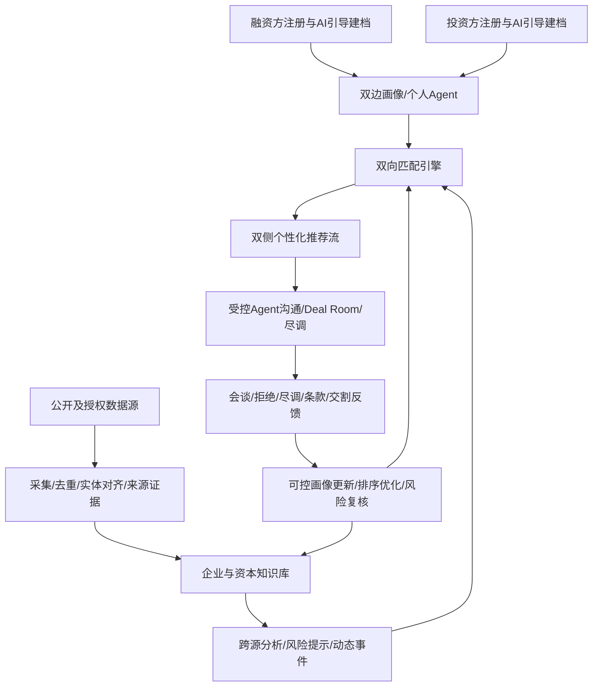
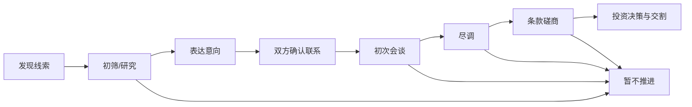
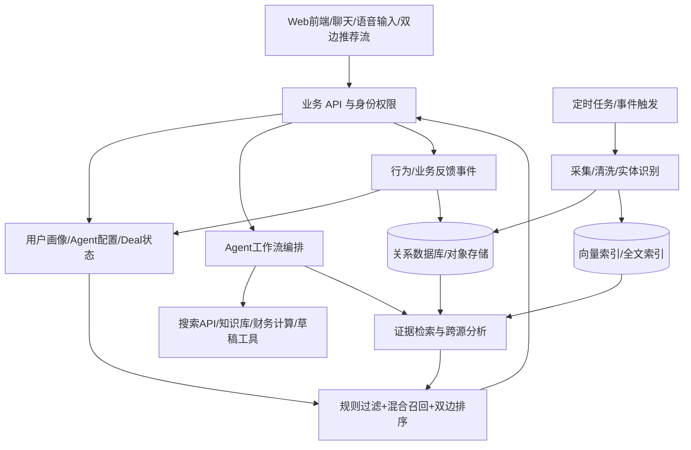

# FundLink AI — 双边智能投融资平台

> **产品需求与方案设计文档（PRD / Solution Blueprint）**  
> 版本：V1.0 · 方案讨论稿  
> 日期：2026-10-09  
> 阶段：面试展示 / 概念验证（Demo），**暂不进入正式产品开发**  
> 核心主题：双侧 AI 建档｜多源数据挖掘｜跨源证据推理｜双向匹配｜个人 Agent｜交易反馈数据飞轮

---

## 0. 执行摘要（Executive Summary）

**FundLink AI 是一个面向创业企业与投资机构的双边智能投融资网络。**

平台分别为融资方和投资方提供个性化 AI Agent：融资方利用 Agent 明确融资需求、寻找合适资本、准备材料并推进沟通；投资方利用 Agent 挖掘潜在创业项目、分析商业价值与风险、寻找符合策略的投资机会并推进尽调。

区别于传统企业数据库、搜索引擎或静态项目撮合平台，FundLink AI 的目标不是单纯“给出一份名单”，而是形成完整闭环：

**主动发现 → 结构化建档 → 跨源验证 → 风险分析 → 双向匹配 → 经授权的交易协作 → 反馈更新。**

平台同时发展两类网络效应：

- **数据飞轮**：更多合规且可追溯的数据及真实反馈，改善下一轮信息发现、风险分析与推荐。
- **双边网络飞轮**：更多优质项目吸引更多资本参与，更多合适的投资机构吸引更多创业者使用。

> **现阶段目标**：为一级市场投资机构展示一个业务逻辑完整、可解释、可模拟操作的 Demo。重点证明 AI 如何改善真实投融资工作流，而非证明模型可以独立作出投资决定。

### 0.1 一句话定位

**让每个创业团队拥有融资 Agent，让每个投资机构拥有投资 Agent；用可验证的数据与持续学习的工作流连接资本和创新。**

### 0.2 三项核心差异化

1. **发现**：不仅搜索已有企业与基金，而且从 GitHub、Hugging Face、论文、新闻、企业网站等公开渠道主动挖掘新的线索及变化。
2. **理解**：不仅看标签是否匹配，而且连接不同来源的数据，解释差异、标注证据、提示风险、列出待核实问题。
3. **执行**：不仅推荐对方，而且在授权范围内准备联系、支持双向沟通、追踪尽调和交易结果，并将反馈用于改善后续服务。

---

## 1. 问题定义与产品机会

### 1.1 融资方痛点

| 典型问题 | 现有困难 | FundLink AI 的回应 |
|---|---|---|
| 不知道适合什么资本 | 创始人不了解 VC、PE、CVC、债务资金差异 | 通过 AI 问答形成融资画像，提供资本类型及融资准备度建议 |
| 找不到合适的投资机构 | 缺乏投资人关系、偏好信息不透明 | 主动挖掘基金公开信息，提供有依据的双向匹配 |
| 融资资料不成熟 | BP 叙事、财务指标、融资用途不清晰 | 协助梳理材料、识别缺口、准备不同投资人的沟通版本 |
| 融资沟通成本高 | 重复筛选、个性化介绍和跟进 | Agent 辅助研究、邮件草拟、会议和进度跟踪 |
| 不清楚投资条款风险 | 只关注拿到多少钱 | 提示稀释、控制权、清算优先权、回购/赎回及其他条款风险 |

### 1.2 投资方痛点

| 典型问题 | 现有困难 | FundLink AI 的回应 |
|---|---|---|
| 优质早期项目难发现 | 部分项目未进入成熟创投数据库 | 公开技术平台、产业动态、招聘、论文等多源挖掘 |
| 项目数据分散 | 企业 BP、公开信息和内部访谈难以对齐 | 企业实体关联、统一项目画像、可追溯的证据知识库 |
| 商业与技术研究耗时 | 需要大量查证与整理 | 自动生成初步研究卡、可验证的行业和技术线索 |
| 材料可能存在不一致 | 不同指标、时间和口径难比较 | AI 跨源差异解释、异常发现、待核实假设 |
| 投资偏好难被系统理解 | 实际行为与公开投资策略不总一致 | 显式策略 + 可控行为画像 + 人工修正 |

### 1.3 产品不是什么

- **不是仅有关键词筛选的企业库**：搜索是入口，不是最终价值。
- **不是自动群发邮件工具**：外联重视授权、个性化、合规和真实互动。
- **不是“预测企业一定会成功”的黑箱评分器**：给出事实、假设、风险和可追溯理由，而不冒充确定性投资判断。
- **不是自动替代投资委员会、律师或财务顾问的交易系统**：复杂决策与有法律效力的动作保留人工控制。

---

## 2. 目标用户与角色

### 2.1 融资方（Founder / Company）

- 已成立的初创企业和成长期企业。
- 有潜在商业化需求的研究团队、开源项目团队。
- 需要产业资本、VC/CVC 或其他资金来源的企业经营者。
- 早期用户可能不理解金融术语，需要引导式建档和融资教育。

### 2.2 投资方（Investor / Fund）

- VC、成长投资基金、部分 PE、CVC、产业基金、家族办公室、合规的天使投资主体。
- 投资经理、分析师、基金合伙人、投后与行业研究人员。
- 机构投资策略与员工个人兴趣需要分开建模；员工个人行为不得直接改写基金授权策略。

### 2.3 平台角色

- **访客 / 未认领主体**：由公开数据发现，属于“公开线索”，**不等于已注册、授权或愿意融资/投资**。
- **已注册主体**：完成基础建档，可自行更新偏好。
- **已验证主体**：按需要核实公司或机构身份、授权代表关系。
- **平台研究/运营人员**：审核异常、整理数据质量、管理演示用案例。
- **可扩展角色**：FA（财务顾问）与产业服务商可作为后续扩展，MVP 不强制纳入。

---

## 3. 核心设计原则

1. **双边对称、业务不完全对称**：双方都有发现、画像、匹配和 Agent，但投资侧侧重价值判断与风险，融资侧侧重资本适配与融资条件。
2. **先有用，再规模化**：用户即使未等到匹配成功，也能从 BP 梳理、行业研究、资本分析中获益。
3. **明确意图优先于行为推断**：浏览偏好不等于投资授权；“感兴趣”不等于融资承诺。
4. **证据和推断分离**：公开事实、用户自述、模型假设、人工验证有独立标识。
5. **匹配必须双向成立**：基金愿不愿意投、公司愿不愿意接受该笔资金，同样重要。
6. **风险提示必须可解释**：说清“发现了什么、证据是什么、为什么值得核实、下一步做什么”。
7. **工具调用可控**：检索和研究可自动化；外发、共享敏感资料、签约等需要明确许可或人工确认。
8. **Demo 有清楚边界**：真实来源的内容标注出处，虚构企业、模拟反馈与演示评分明确标注模拟。

---

## 4. 产品模块总览

| 编号 | 模块 | 核心能力 | 面试 Demo 展示优先级 |
|---|---|---|---|
| M1 | AI 引导式注册与画像 | 双身份、文字/语音、约 10 维自适应问答、初始 Agent | P0 |
| M2 | 多源数据挖掘与项目雷达 | GitHub、HF、arXiv、新闻、基金动态等增量发现 | P0 |
| M3 | 企业/资本画像与知识库 | 实体去重、资料关联、来源引用、动态更新 | P0 |
| M4 | Evidence Reasoning & 风险雷达 | 跨源对齐、差异解释、假设、尽调建议 | P0 |
| M5 | 双向智能匹配与推荐流 | 约束过滤、解释推荐、换一批、收藏、反馈 | P0 |
| M6 | 自定义融资/投资 Agent | 专属目标、工具能力、计划、受控执行 | P0 |
| M7 | Deal Room / 交易工作台 | 双向意向、材料、邮件草稿、会谈/尽调状态 | P1 |
| M8 | 反馈学习与数据飞轮 | 事件日志、画像建议、风险复核、推荐重排 | P0 演示闭环 |
| M9 | 融资/投资专业工具 | Runway、股权稀释、融资类型、尽调框架 | P1 |
| M10 | 机会监测（Watch） | 项目变化、投资机构新动态、触发式重新研究 | P1 |

### 4.1 总体业务流程



---

## 5. M1：AI 引导式注册、问答与画像

### 5.1 注册体验

用户选“我要融资”或“我要投资”，通过**文字、语音、推荐选项、自由输入**完成一次约 10 个主题的引导式访谈。

- 一次只问一个问题，避免长表单的认知负担。
- AI 根据回答适时解释金融概念，提出有限度的追问。
- 每题均支持“其他／自行输入”“暂不确定”“跳过”。
- 如果先前答案已包含后续问题所需信息，可跳过重复提问。
- 核心金额、地域、轮次、限制条件等提取结果需供用户确认。
- 语音先转写再结构化，展示转写结果，尤其注意货币金额和日期。
- 10 题是**核心信息维度**，并非不可改变的机械题数。
- 初次注册只建立基础画像，随后可渐进完善专业材料。

### 5.2 投资方 10 个核心问题

| # | 问题主题 | 可能选项/补充说明 | 画像字段 |
|---|---|---|---|
| 1 | 您的身份和投资主体？ | VC、PE、CVC、家办、天使、个人研究者等 | investor_type |
| 2 | 您投资的主要目的？ | 财务回报、产业协同、战略布局、探索 | objective |
| 3 | 您关注哪些行业？ | AI 应用、机器人、半导体、医疗等；不确定可探索 | sectors |
| 4 | 您倾向什么企业阶段？ | 概念验证、种子轮、天使轮、A/B 轮、成长期 | stages |
| 5 | 单笔投资规模？ | 金额区间与币种；未知可跳过 | ticket_range |
| 6 | 投资地域？ | 中国、美国、东南亚、全球等 | regions |
| 7 | 您评估企业最看重什么？ | 技术、团队、收入、客户、盈利、增长等 | evaluation_priorities |
| 8 | 您通常扮演什么角色？ | 领投、跟投、战略合作、不确定 | deal_role |
| 9 | 哪些条件不可突破？ | 不投行业、投资权限、地域、最低阶段、利益冲突等 | hard_constraints |
| 10 | 您希望 Agent 帮您做什么？ | 找项目、研究、风控、监测、尽调、沟通 | agent_goals |

**特殊逻辑**：用户不知道投什么，可询问“更关注技术突破、商业化确定性还是增长空间？”据此形成**待确认的探索性偏好**，而不是假装用户已经明确了投资策略。

**重要区分**：专业基金的正式投资限制、审批权限以及个人投资者的适当性/资格核验，均需要单独信息与合规流程；上述问答不能替代法定核验。

### 5.3 融资方 10 个核心问题

| # | 问题主题 | 可能选项/补充说明 | 画像字段 |
|---|---|---|---|
| 1 | 您代表企业还是项目团队？ | 公司、未注册团队、科研成果转化 | entity_type |
| 2 | 您的产品/业务做什么？ | 自由描述；AI 提取行业和场景 | business_description |
| 3 | 企业目前处于什么阶段？ | 想法、原型、试点、已上线、规模化 | development_stage |
| 4 | 当前商业化情况？ | 尚未收费、试点、付费客户、稳定收入 | traction |
| 5 | 希望融多少钱？ | 数字与币种、区间或“帮我估算” | target_amount |
| 6 | 经营和融资涉及哪些地域？ | 国内、海外、多地区 | operating_regions |
| 7 | 融资资金主要用在哪里？ | 研发、生产、招聘、市场、周转等 | use_of_funds |
| 8 | 何时需要资金？ | 3/6/12 个月或尚不确定 | time_horizon |
| 9 | 接受什么融资方式和边界？ | 股权、债务、战略投资、不了解；控制权关注点 | financing_preference |
| 10 | 希望资本带来什么？ | 资金、客户、渠道、供应链、技术、长期陪伴 | non_financial_needs |

**特殊逻辑**：用户说“想融资 5000 万但不知道金额如何确定”，Agent 不应马上把 5000 万视为合理融资需求；应建议后续填写资金使用计划、现金储备、月度净消耗、目标里程碑等，再做融资需求诊断。

### 5.4 画像的四种信息属性

| 信息属性 | 示例 | 处理原则 |
|---|---|---|
| 用户明确声明 | “只投 A 轮及以后” | 高优先级；可由用户修改 |
| 用户自述事实 | “已有 20 个付费客户” | 可以存储但标记“自述、待验证” |
| AI 推断 | “可能更偏工业 AI” | 不视为事实；可请求用户确认 |
| 外部/人工验证 | 经来源核实的投资公告 | 附出处、时间、验证状态 |

**需要保留时间维度**：同一家公司三个月前没有付费客户、目前已有付费客户，是动态变化；不能用旧数据覆盖新数据却不保留历史。

### 5.5 注册后渐进式完善

- **融资方详情**：企业名称及主体、创始团队、产品、竞争优势、客户及收入、财报、BP、Cap Table（股权结构）、融资用途、估值期望、已融轮次、历史投资方等。
- **投资方详情**：基金管理主体、投资授权、策略、票面金额、重点行业、地域、历史项目、决策流程、是否领投、战略资源、潜在冲突等。
- 默认进行资料分级：公开资料、仅己方可见、匹配后经授权分享、特定尽调室分享。

---

## 6. M2：双边多源数据挖掘（Deal & Capital Discovery）

### 6.1 目标

平台应同时主动发现：

1. **新创业项目与潜在融资线索**：并非所有优质团队都出现在商业投资数据库里。
2. **活跃投资机构与潜在资本需求**：不仅关注基金官网描述，也跟踪公开投资行为与基金动态。

从公开数据中发现“可能值得关注”，**不等于**证实“正在融资”“有资金可投”或“愿意联系”。

### 6.2 建议数据源

| 类别 | 示例来源 | 可观察信号 | 限制与注意事项 |
|---|---|---|---|
| 开源技术 | GitHub | Repo Star/贡献者/Release/提交变化、话题 | Repo 不等于公司；Star 不等于收入 |
| AI 开源生态 | Hugging Face | 模型发布、下载量、生态互动 | 下载量不等于商业客户 |
| 研究论文 | arXiv、研究机构页面 | 论文、研究主题、作者网络 | 作者不一定创业；需核验商业主体 |
| 企业官网 | 官网、产品文档、案例页 | 产品更新、定价、客户案例 | 官宣属于企业自述，不等于独立验证 |
| 招聘与公司动态 | 企业官方招聘页、授权平台 | 扩张方向、岗位变化 | 招聘信号不可直接推导经营好坏 |
| 新闻与融资公告 | 官方新闻、媒体、机构公告 | 轮次、金额、投资主体、产业方向 | 注意发布时间、复述转载和独立证据 |
| 基金信息 | 基金官网、已投组合、公开备案或公告 | 投资重点、历史项目、可能新设基金 | 不能仅凭公告推断剩余可投金额 |
| 用户授权资料 | BP、财务、运营指标、投资策略 | 准确信息及深度分析 | 权限隔离、使用授权、保密要求 |

### 6.3 挖掘流程


建议 Demo 展示两种触发：

- **立即执行**：点击“扫描 GitHub 新兴 AI 项目”。
- **模拟定时任务**：界面显示“每日巡检”及最近一次发现、更新、待核实项目数。实际后台定时任务可放在下一阶段。

### 6.4 早期项目信号设计

可观察信号包括：开发者活跃度、增长趋势、模型/论文发布、商业化入口、试点客户新闻、招聘方向、公司注册与融资公告等。

但需要区分：

- **技术热度**不等于商业价值；
- **商业化线索**不等于已经形成收入；
- **融资历史**不等于正在寻求下一轮融资；
- **基金投资历史**不等于目前拥有对应轮次可用额度。

### 6.5 项目动态监测（Opportunity Watch）

关注企业或基金后，AI 记录关键变化事件，例如：

- 新产品、开源项目或重大版本发布；
- 公布付费客户、试点合作、商业订单；
- 新融资/基金成立公告；
- 投资机构新增某赛道公开投资案例；
- 与用户设定的投资/融资条件相关的重大变化。

满足条件时生成“建议重新评估”而不是未经判断直接修改投资建议。

---

## 7. M3：企业与资本画像、证据知识库

### 7.1 两个核心画像

**Company Profile**：企业主体、技术产品、团队、目标市场、客户与商业化、财务、融资轮次、融资诉求、公开和授权证据、风险记录、变化时间线。

**Capital Profile**：机构与基金主体、投资人角色、行业/阶段/地域/票面金额、财务或产业目标、历史项目、近期公开投资行为、基金限制、偏好变动、潜在风险。

附加两个持续变化的画像：

- **Agent Profile**：该用户的 Agent 目标、可调用工具、沟通偏好、工作流模板和审批权限。
- **Behavior & Deal Profile**：经授权记录的搜索、收藏、沟通、尽调与交易反馈；与明确画像分离。

### 7.2 实体关系图谱（可先用关系型表实现）

节点：Company、Project/Repository、Product、Person、Fund、Investor Organization、Deal、Evidence、Risk Finding、Event。

关系示例：

- `REPO_MAINTAINED_BY`（项目由谁维护）
- `COMPANY_OWNS_PRODUCT`（企业拥有产品）
- `FUND_INVESTED_IN_COMPANY`（基金已公开投资企业）
- `EVIDENCE_SUPPORTS_CLAIM`（证据支持陈述）
- `EVIDENCE_CONTRADICTS_CLAIM`（证据与陈述可能冲突）
- `INVESTOR_EXPRESSED_INTEREST`（投资方表达意向）
- `DEAL_STAGE_CHANGED`（交易进度变化）

**实体对齐尤其重要**：GitHub 组织、论文作者、官网主体和工商法人可能并非同一主体；未确认的映射必须显示为“疑似关联”。

### 7.3 证据对象最小字段

```yaml
evidence_id: ev_001
subject_id: company_001
claim: "企业已拥有付费客户"
source_type: company_website
source_url: "https://example.org/news"   # 示例网址
published_at: "2026-09-01"
collected_at: "2026-10-09"
claim_type: self_disclosed
verification_status: unverified
confidence_label: medium
visibility: public
notes: "企业自述，需核验合同与回款"
```

公开演示可使用模拟数据，但**链接和来源若是模拟的，必须明确标记，不可伪装为已检索的真实内容**。

### 7.4 用户资料与公开线索必须分开

公开检索得到的企业只是**平台已发现的候选主体**。只有经过本人认领或授权后，才能作为平台用户执行敏感资料共享、对外代表联系等操作。

---

## 8. M4：跨源证据推理与风险识别（Evidence Reasoning）

### 8.1 核心任务

不是让大模型直接“判断公司好不好”，而是：

**抽取主张 → 找到支持证据 → 对齐实体/时间/指标口径 → 判断是否可比较 → 检查差异 → 提出合理假设 → 提供核实任务。**

### 8.2 标准分析输出格式

每张分析卡包含：

1. **Claim（主张）**：谁声称了什么，具体日期和口径。
2. **Evidence（证据）**：链接、原始资料、出处、采集时间。
3. **Finding（发现）**：一致、矛盾、可能存在差异、暂无足够证据。
4. **Hypotheses（解释假设）**：可能的商业、会计或技术原因，不能冒充事实。
5. **Risk Priority（核查优先级）**：高/中/低，重点表示核查紧迫性而非企业质量。
6. **Next Action（尽调动作）**：应补哪些文件、问谁、怎样验证。
7. **Review Status（复核状态）**：待核实、已解释、已验证、误报、无法确认。

### 8.3 金融跨源案例：ARR 与营业收入差异

**模拟情境**：公司 BP 声称 ARR 为 1,200 万元，财报显示 2025 年已确认营业收入 400 万元。

系统应先判断：ARR 通常为某一时点经常性业务收入的年化指标，而营业收入为会计期间内确认的收入，**二者不必相等**。之后检查：

- 合同是否在年底集中生效？
- ARR 是否包含非经常性项目收入？
- 合同是否真正生效、有无取消/退款风险？
- 收入确认政策、回款记录与合同执行是否一致？

输出的结论应是“存在值得核实的口径差异”，而不是“发现财务造假”。

### 8.4 技术与经营跨源案例

**模拟情境**：企业自述研发高速推进，但公开 GitHub 更新变少、招聘职位减少。

可能解释：

- 项目从公共仓库迁到私有仓库；
- 阶段性产品稳定，公开迭代变少；
- 业务战略调整；
- 也可能存在经营压力。

Agent 下一步应查找产品 Release、企业访谈、团队配置、研发费用和经营现金流，避免将表面相关性直接视为因果关系。

### 8.5 投资方风险类别

| 风险类型 | 可疑信号 | 推荐尽调动作 |
|---|---|---|
| 技术 | 核心能力严重依赖外部模型、知识产权权属不清 | 代码/许可证核验、技术访谈 |
| 产品与市场 | 声称 PMF，但缺少付费及留存证据 | 客户访谈、合同与续约核验 |
| 团队 | 关键人员披露不一致 | 经授权核实履历及任职关系 |
| 财务 | 收入、ARR、回款或现金消耗口径冲突 | 调取经授权的财务资料、核算 |
| 法律合规 | IP、合同、数据保护等疑点 | 专业法律审查 |
| 融资交易 | 估值与成长进度脱节、Cap Table 复杂 | 股权结构、条款和情景分析 |

### 8.6 融资方风险类别

| 风险类型 | 可能问题 | 推荐分析 |
|---|---|---|
| 机构身份与能力 | 机构主体不明、资金能力未经验证 | 官方信息、公开交易记录、直接确认 |
| 策略不匹配 | 历史投资与公开策略不一致 | 对齐时间与基金主体，进一步询问 |
| 利益冲突 | 已投直接竞争公司 | 提前评估保密及信息隔离 |
| 控制权 | 董事会权利、重大事项否决权 | 条款比较与专业审查 |
| 回报与退出 | 回购、赎回、清算优先权等可能过重 | 交易情景分析与法律咨询 |
| 战略约束 | 排他性、知识产权或客户渠道限制 | 评估对长期独立性的影响 |

### 8.7 AI、代码和人的分工

- **规则与 Python/SQL**：单位换算、财务公式、数值一致性检查、时间序列统计。
- **LLM**：阅读非结构化资料、信息抽取、假设生成、关联解释、尽调清单。
- **检索及来源系统**：提供具体证据，不靠模型记忆编造企业事实。
- **人工研究员**：审阅高风险结论、确认需要联系的人、判断是否推进。

---

## 9. M5：双向智能匹配与“招聘式”推荐流

### 9.1 推荐流体验

分别提供：

- 融资方首页：“为你推荐的投资机构”。
- 投资方首页：“为你推荐的创业项目”。

卡片可操作项：查看理由、查看来源、收藏、感兴趣、不感兴趣、换一批、请 Agent 研究、申请联系。

交互借鉴 BOSS 直聘，但**核心不是招聘形式本身，而是高质量解释、受控行动和持续反馈**。

### 9.2 两阶段匹配

**第一阶段：硬性条件过滤（Eligibility）**

- 行业禁止/排除清单、基金投资范围。
- 投资阶段、单笔金额、地区与币种等限制。
- 必要身份、权限、合规、利益冲突限制。
- 企业明确排除的投资者类型和不可接受条款。

不满足明确硬约束时原则上不进入正常推荐；可独立提供“相近但不满足某条件”的探索区，不隐瞒原因。

**第二阶段：多维推荐排序（Ranking）**

- 行业及技术契合度；
- 投资阶段/票面金额相容性；
- 资本增值需求与战略资源协同性；
- 投资人显式偏好及经授权的交互反馈；
- 项目资料完整性与证据新鲜度；
- 新发现机会与用户尚未探索的方向。

### 9.3 双向匹配，不只是单侧高分

可先分别估算：

- `InvestorFit(company, fund)`：该公司是否符合基金策略。
- `FounderFit(fund, company)`：该基金是否符合企业资金和合作需求。

示例演示组合分（仅用于 Demo 排序，不作为投资预测）：

```text
PairScore = 0.5 × InvestorFit + 0.5 × FounderFit

前置条件：先通过硬约束过滤。
同时独立展示：数据可信度、风险核验优先级、尚未确认的信息。
```

**重要**：匹配度、风险大小、证据质量应分开呈现；不建议揉成一个神秘的“投资成功率 93%”。

### 9.4 行为画像与“换一批”

- **显式偏好**：用户问卷、聊天确认的目标，优先级最高。
- **隐式偏好**：浏览、收藏、跳过、停留、进一步约谈等，仅作为不同权重的信号。
- **真实业务反馈**：拒绝原因、进入尽调、条款谈判、最终投资等，可在授权后用于调整排序。

“换一批”推荐逻辑：

1. 排除最近已展示且被主动跳过的相同项目（必要时允许再查看）。
2. 保留一部分高契合推荐。
3. 补充新发现企业/基金。
4. 加入少量多样化探索项，并说明推荐缘由。
5. 不跨越硬性投资边界。

### 9.5 可解释推荐卡的必备内容

- 推荐对象基本资料。
- **为什么适合你**：最多 3 条具体理由。
- **关键证据**：对应来源及时间。
- **需要核实**：最多 2 条不确定性。
- **建议下一步**：研究、联系、要求补充资料。
- “暂不符合”：解释差在哪里，以及可能如何调整需求或寻找其他来源。

---

## 10. M6：每个人拥有自己的 AI Agent

### 10.1 注册即生成初始 Agent

使用 M1 画像生成默认配置：

```yaml
agent_type: investor
objective: "发现有付费客户的工业AI企业"
sectors: [industrial_ai, enterprise_software]
stages: [pre_a, a, b]
ticket_range_cny: [10000000, 30000000]
tools_enabled: [public_search, knowledge_base, company_research, risk_review]
outbound_policy: approval_required
investment_decision: human_only
```

用户可以在聊天框通过自然语言修改：例如“少推荐纯模型公司，多看已经拿到制造业客户的项目”。

### 10.2 融资 Agent 的典型任务

1. 阅读企业 BP 和融资资料。
2. 完善融资叙事、识别资料缺口。
3. 提供融资需求和资本类型分析。
4. 挖掘并比较目标基金。
5. 生成针对不同基金的推荐理由与邮件草稿。
6. 经确认后发起联系和跟进。
7. 协助整理会谈问题、文件需求和交易进度。

### 10.3 投资 Agent 的典型任务

1. 按策略巡检新企业和技术项目。
2. 构建可追溯企业画像。
3. 研究市场、竞品、团队与技术信号。
4. 分析材料差异并生成尽调问题。
5. 生成初步投资机会备忘录。
6. 在投资人确认后发起沟通或索取资料。
7. 跟踪关键变化并提醒重新研究。

### 10.4 Agent 工具能力

| Tool | 功能 |
|---|---|
| `search_public_sources` | 搜索公开公司、基金、项目及新闻 |
| `fetch_repo_metadata` | 调用 GitHub 等公开接口 |
| `retrieve_evidence` | 从知识库按权限检索证据 |
| `extract_structured_profile` | 从自然语言/BP 提取资料草稿 |
| `compare_claims` | 分析不同来源的差异 |
| `calculate_financial_metrics` | 财务及股权公式计算 |
| `rank_counterparties` | 双侧匹配排序与解释 |
| `draft_outreach` | 生成定制化沟通草稿 |
| `request_approval` | 联系、共享材料等高风险动作前请求确认 |
| `track_deal` | 记录业务节点和后续事项 |

### 10.5 权限分级

| 等级 | 能力 | 执行原则 |
|---|---|---|
| L0 | 阅读公开信息、回答问题 | 可自动执行 |
| L1 | 在本人工作区整理、研究和起草 | 可按设置自动执行 |
| L2 | 分享资料、发送消息、邀约第三方 | 经用户确认且满足接收方规则 |
| L3 | 变更投资条款、资金转移、签署协议 | Demo 不实现；真实业务需专门授权与合规流程 |

> 多 Agent 可以作为内部工作流组织方式，但第一版无需为了炫技而堆叠多个自治 Agent。单个协调 Agent + 可靠工具更适合 MVP。

---

## 11. M7：双边 Deal Room 与交易工作流

### 11.1 交易状态机（简化）



用户可看到：

- 当前阶段、负责人、关键待办。
- 需要补充的资料及访问权限。
- 联系邮件草稿、会议纪要、待核实尽调问题。
- 双方明确的兴趣反馈和拒绝原因（仅对有权限的一方可见）。
- 已解决和未解决的风险提示。

### 11.2 双向尽职调查

**投资方查企业**：业务真实度、技术、团队、市场、财务、治理、法律、股权、退出等。

**企业查资本**：机构身份、投资阶段、利益冲突、出资安排、增值资源、控制权、信息共享和合同条款等。

双向尽调的作用不是保证交易完成，而是更早发现不合适的合作和潜在风险。

---

## 12. 金融业务能力设计（面向一级市场）

本节是为了填补产品方案的金融专业部分，**不是要在 Demo 中搭建完整投行业务系统**。

### 12.1 资本类型诊断

| 资本类型 | 更可能适用的场景 | 常见注意事项 |
|---|---|---|
| 天使/种子 VC | 技术或商业模式早期验证 | 稀释、未来融资能力、估值 |
| VC/成长基金 | 产品与商业模式具有增长潜力 | 增长预期、治理、退出路径 |
| CVC/产业资本 | 产业协同、渠道、技术/供应链合作 | 利益冲突、排他性、商业独立性 |
| PE（偏成熟阶段） | 稳定经营、成长扩张或并购场景 | 现金流、估值、治理及退出 |
| 债务/银行融资 | 具备偿债能力和适合的资金用途 | 本息负担、期限、担保与契约 |
| 政策/科研类资金 | 符合特定项目或研发资助条件 | 资格、用途限制、审核周期 |

### 12.2 入门计算模块

**毛利率**：`(收入 - 营业成本) / 收入`

**静态现金可维持时间**：`现有现金 / 月度净现金消耗`（只作简化估算；若未来现金流不稳定则需预测模型）

**投后估值**：`投前估值 + 本轮新注入的股权融资金额`

**新投资人股权占比（简化）**：`本轮投资金额 / 投后估值`

**投资回报倍数（MOIC，简化）**：`回收价值 / 已投资本`

估值方法可按公司阶段选择：可比公司/交易案例、Revenue Multiple、成长和回报情景、DCF（具备可支持的长期现金流预测时）。不能直接拿未盈利种子轮企业套用市盈率作唯一判断。

### 12.3 投资方尽调最小框架

1. **行业与市场**：需求、TAM/SAM/SOM 的假设、规模及竞争格局。
2. **团队与治理**：创始团队背景、股权、组织关键岗位。
3. **产品与技术**：技术真实性、IP、产品稳定性、差异化。
4. **商业化**：客户数量、付费、留存、续约、销售周期、收入质量。
5. **财务**：历史报表、毛利、净现金消耗、Runway、应收账款。
6. **融资及条款**：估值、轮次、稀释、优先权、未来融资空间。
7. **风险与退出**：法律、监管、竞争、投资回报情景。

### 12.4 融资方资本适配框架

1. 融资金额与资金用途是否合理。
2. 拟用资金能够支撑哪些可验证的业务里程碑。
3. 不同资本来源的成本与附带条件。
4. 股权稀释、控制权和既有股东权利影响。
5. 投资人提供的产业资源是否可信、是否适合公司战略。
6. 可能的投资人冲突、保密与排他要求。
7. 交易周期是否符合企业实际现金需求。

---

## 13. M8：行为画像、反馈机制与数据飞轮

### 13.1 用户行为信号分层

| 层级 | 示例 | 如何使用 |
|---|---|---|
| 弱兴趣信号 | 浏览、停留、搜索、换一批 | 仅用于轻量个性化探索 |
| 中兴趣信号 | 收藏、主动查看完整资料、要求深入研究 | 提高相似主题推荐，但不改硬性约束 |
| 强业务信号 | 发送意向、正向回复、约谈 | 学习真实匹配与联系偏好 |
| 交易进展信号 | 开始尽调、条款磋商、最终成交 | 评估推荐是否产生有效业务结果 |
| 风险反馈信号 | 提示被证实、已解释、误报 | 优化跨源分析和尽调优先级 |

要警惕样本偏差：热门赛道曝光越多可能获得越多反馈，不能把曝光量误读为投资价值；少量用户行为不应导致画像剧烈漂移。

### 13.2 两个飞轮


**数据飞轮**重点指标：资料覆盖、实体对齐准确度、风险误报、有效匹配率、进入会谈/尽调转化。


**网络飞轮**是愿景，不是已经被证实的事实。需要验证两侧的质量、活跃度、留存与交互转化。

### 13.3 反馈不能自动越权

- 模型可以提出“您的近期兴趣可能有所变化”。
- 用户可确认、忽略或撤销画像更新。
- 不因个人点击改变基金正式投资授权。
- 不把一家机构的非公开尽调资料泄露或直接供其他机构查询。
- 不以未经批准的用户私有内容训练可跨客户复用的模型。

---

## 14. 算法与技术架构（面向可演示 MVP）

### 14.1 系统逻辑分层



### 14.2 推荐技术栈（并非必须全部实现）

| 功能 | 建议方案 | Demo 取舍 |
|---|---|---|
| 前端 | React / Next.js | 展示双端页面、聊天、推荐流 |
| 后端 | Python FastAPI | 提供基础 API 即可 |
| 数据库 | PostgreSQL / Supabase | 存储主体、画像、证据、反馈 |
| 文档和对象 | 文件存储 + 解析 | 演示用虚构 BP 或自有资料 |
| 检索 | SQL 过滤 + Full Text + Embeddings | 小样本可本地混合排序 |
| 数据挖掘 | GitHub API、公开搜索及合规数据接口 | 真正打通 1–2 个数据源即可 |
| 模型层 | LLM Structured Outputs / Tool Calling | 重点做信息提取、假设、报告草稿 |
| 任务编排 | 轻量工作流 / LangGraph（可选） | 优先可靠性和可观察性 |
| 定时任务 | Scheduler / Cron | Demo 可用手动触发加模拟时间线 |
| 语音 | ASR（语音转文字） | 如时间有限可只做文本输入 |
| 监控 | 调用日志、证据 ID、异常记录 | 足够支撑演示追溯即可 |

### 14.3 一个简单但合理的匹配算法

```python
# 概念性伪代码，非生产级金融模型

def recommend(company, funds, user_profile, evidence_index):
    eligible = [
        fund for fund in funds
        if satisfies_hard_constraints(company, fund)
    ]
    candidates = hybrid_retrieve(eligible, company.description, evidence_index)
    for fund in candidates:
        investor_fit = score_investor_fit(company, fund)
        founder_fit = score_founder_fit(company, fund)
        fund.demo_match_score = 0.5 * investor_fit + 0.5 * founder_fit
        fund.evidence = explain_match(company, fund)
        fund.uncertainties = identify_information_gaps(company, fund)
    return diversify_and_rank(candidates)
```

**不要误用这个分数**：它是演示的推荐排序信号，不能称为“融资成功概率”。

### 14.4 跨源分析管线

```text
文档/网页/JSON
    ↓
结构化抽取：主体、指标、金额、币种、时间、口径、来源
    ↓
实体对齐和单位/时间口径统一
    ↓
数值/规则校验：发现不可直接比较项、异常与缺口
    ↓
LLM + 来源检索：解释假设、支持/反对证据
    ↓
风险卡：事实 / 不确定性 / 核查优先级 / 尽调任务
    ↓
人工反馈：真实解释 / 误报 / 待核实
```

---

## 15. 数据结构最小草图

以下字段是概念模型，不是生产数据库最终表结构。

| 对象 | 核心字段 |
|---|---|
| `users` | user_id、role、verification_status |
| `companies` | company_id、entity_status、name、industry、stage、region、funding_needs |
| `funds` | fund_id、org_id、sectors、stages、ticket_range、regions、hard_constraints |
| `profiles` | profile_id、owner_id、declared_preferences、inferred_preferences、version |
| `agents` | agent_id、owner_id、objectives、tool_permissions、approval_settings |
| `source_items` | source_id、url、published_at、collected_at、access_level |
| `claims` | claim_id、subject_id、metric、value、period、source_id、status |
| `relationships` | subject_id、relation_type、object_id、confidence、evidence_id |
| `risk_findings` | risk_id、company_or_fund_id、evidence、hypotheses、review_status |
| `recommendations` | owner_id、counterparty_id、reason、score、shown_at |
| `deals` | deal_id、company_id、fund_id、stage、owner、permissions |
| `events` | event_id、actor_id、event_type、subject_id、timestamp、consent_scope |

特别重要：**source_items / claims / permissions** 应是底层基础能力，而不是后面给报告加一条假链接。

---

## 16. 完整用户旅程（User Journeys）

### 16.1 投资人视角

1. 进入平台，选择投资方。
2. 通过文字/语音完成约 10 个主题的 AI 建档。
3. 获得个人 Agent，查看行业/阶段/金额偏好。
4. 首页出现“为你推荐的企业”，可刷新换一批。
5. 发现一家公司，查看技术、商业化、融资需求及来源。
6. 点击“让 Agent 深入研究”，查看跨源证据、风险、待核实清单。
7. 感兴趣后，生成个性化联系草稿，经确认发起沟通。
8. 进入会谈/尽调，记录真实反馈。
9. 平台提出画像优化建议，下一轮推荐改善。

### 16.2 融资方视角

1. 进入平台，选择融资方。
2. AI 询问产品、客户、融资金额、资金用途和希望资本提供什么资源。
3. 获得融资画像及个人融资 Agent。
4. 首页展示符合条件的基金与资本类型，注明依据和疑问。
5. 对目标基金查看历史公开投资、近期动态与合作风险。
6. Agent 辅助完善 BP、融资计划、可比机构研究和联系草稿。
7. 双方表达意向后，进入受控 Deal Room。
8. 根据反馈更新融资策略，而不是机械地重复群发。

### 16.3 未注册线索如何转换

公开平台发现潜在技术团队 → 标记为**未认领候选项目** → 研究其技术与商业化迹象 → 为投资人提供公开研究卡 → 若合适，在合法和平台规则允许的情况下提出合规联系建议 → 创业者认领及授权后才进入深度融资流程。

---

## 17. 3–5 分钟 Demo 故事板（暂不开发）

**建议始终使用一笔虚构交易贯穿演示**。示例：一家名为 *IndustrialMind AI* 的工业 AI 企业，希望融资 3,000 万元；一家虚构的“制造业科技基金”关注已具备付费客户的工业 AI 项目。

| 时间 | 场景 | 让面试官看到的差异化价值 |
|---|---|---|
| 0:00–0:35 | 两侧 AI 自适应注册：分别输入融资诉求和投资偏好 | 用户不需要懂复杂金融分类也能建档 |
| 0:35–1:10 | 项目雷达：扫描 GitHub 等渠道的新增线索 | 平台能主动发现非现成数据库项目 |
| 1:10–1:55 | 项目画像：企业官网、开源数据、BP 与来源引用 | 碎片化信息连接成可追溯知识 |
| 1:55–2:35 | 风险分析：收入指标差异及尽调追问 | AI 不只是匹配，还能理解口径和提出验证任务 |
| 2:35–3:20 | 双边主页：互相推荐、解释理由、刷新换一批 | 类似招聘平台的高频、可解释交互 |
| 3:20–4:10 | 双方 Agent：生成研究卡和定制沟通草稿 | 从 Search 走向 Execution |
| 4:10–5:00 | 模拟反馈：进入会谈/拒绝/风险已解释；再刷新推荐 | 显示完整反馈闭环和画像变化 |

### 17.1 展示用“必有交互”

- 两端身份切换。
- 一次文字或语音的 AI 引导问答（语音可选）。
- 一次公开数据源调用或明确标注的模拟扫描。
- 一张带证据出处和风险提示的项目卡。
- 一次“换一批”推荐。
- 一次双方 Agent 起草行动计划或联系邮件。
- 一次反馈引起推荐排序变化。

### 17.2 Demo 不必做的功能

- 真正执行投资交割与签约。
- 复杂、多层级的三表预测与估值系统。
- 全网大规模爬取及高并发基础设施。
- 用大量真实交易训练专有排序模型。
- 绕开人工审批的全自动发信、资金划拨或合同签署。

### 17.3 真实与模拟的边界

三种标签清楚区分：

1. **真实公开数据**：可显示真实来源链接与抓取时间。
2. **AI 分析推断**：注明推断、证据和待核实项。
3. **模拟案例与行为**：明确标注虚构企业、虚构基金、模拟投资人反馈。

---

## 18. 冷启动与产品增长思路

### 18.1 双边平台冷启动问题

- 没有项目，投资人不来。
- 没有投资人，创业者也不来。
- 搜索平台已经能提供部分现成资料，仅靠“信息匹配”不足以吸引长期使用。

### 18.2 建议先用独立价值吸引一侧

建议在 Demo 叙事中强调两个可独立使用的入口：

**Founder Fundraising Copilot**：BP 基础诊断、资本类型建议、基金研究、联系草稿。

**Investor Deal Intelligence Copilot**：新项目发现、研究卡、风险提示、重点项目跟踪。

即使短期内双边直接交易数量不大，用户仍然能从 Agent 研究和准备工作中获益。

### 18.3 外部分发方式

- 官网与行业社区，吸引直接建档。
- GitHub 等公开社区发布部分开源工具或开发组件（并非随意收集使用者私有信息）。
- 在支持的 AI 平台推出融资诊断或投资研究相关 Skill / Agent。
- 以有用的研究工具获取自愿注册，再逐渐提升双边网络价值。

“用 Skill 获客”要明确告知信息用途，不能默默将私人对话上传为融资线索。

### 18.4 商业模式候选（Demo 不需决定）

- 个人/小团队：免费基本功能 + 付费深度报告或使用额度。
- 基金与专业团队：机构订阅、工作席位、研究与知识库工具。
- 企业：融资资料准备、投资人研究等订阅或项目服务。
- 交易相关收费：高度依赖法域、牌照与业务结构，**不能预设无资质也可收取融资成功佣金**。

---

## 19. 最小评估指标与验收标准

### 19.1 产品体验指标

| 指标 | Demo 想证明什么 |
|---|---|
| 注册完成率、平均时间 | 用户是否能快速建档，不因金融术语放弃 |
| 画像可解释度 | 用户能否查看并更正 AI 对其需求的理解 |
| 推荐相关性 | 双方是否认同推荐理由及基本条件 |
| 换一批差异 | 刷新是否带来新且合理的候选对象 |
| Agent 任务完成率 | 研究/草稿能否按权限完成而非只会聊天 |

### 19.2 数据与研究质量指标

| 指标 | 预期价值 |
|---|---|
| 发现线索的可核验比例 | 避免垃圾线索与虚构企业 |
| 实体关联准确率 | 避免将个人 Repo 误认为公司 |
| 证据引用覆盖率 | 推荐与风险结论可追踪 |
| 风险提示人工误报率 | 评估风险雷达是否过度报警 |
| 数据更新时间 | 体现项目和资本动态变化 |

### 19.3 未来业务指标（不是 Demo 已达成成果）

- 投资经理正向回复率。
- 双方会谈转化率。
- 进入尽调率。
- 从推荐到有效会谈的时间。
- 进入条款磋商、最终交割的转化率。
- 机构与创业者的重复使用率。

**注意**：最终融资成交率不应被视为唯一模型质量指标，因为宏观市场、关系网络、交易条款及人为决策均会显著影响结果。

---

## 20. 开发阶段与交付范围

| 阶段 | 主要目标 | 应交付的可验证结果 |
|---|---|---|
| **P0：产品方案** | PRD、用户旅程、业务边界、关键流程 | 本文档、信息架构、演示故事板 |
| **P1：交互原型** | 双侧注册、画像、推荐流、Agent UI | 可点击、可刷新、可解释的原型 |
| **P2：真实数据闭环** | 1–2 个真实公开源、证据化项目卡 | 从数据源到画像与风险分析的可追溯链路 |
| **P3：基础 Agent 工具链** | 检索、资料分析、财务计算、草稿 | 受控工具调用和人工确认流程 |
| **P4：反馈与验证** | 行为事件、复核、排序变化 | 能展示反馈前后差异及基本评测 |

### 20.1 第一版 Demo 最小集合（推荐）

只需做到：

1. 融资方和投资方各有一套 AI 引导式建档。
2. 系统展示一批有出处或明确标注模拟的企业与基金信息。
3. 展示一次跨源风险分析与待核实问题。
4. 双向推荐流可解释且能“换一批”。
5. 双方 Agent 可以草拟下一步研究与沟通任务。
6. 一个模拟业务反馈能改变排序或画像建议。

> 对面试来说，**一条能从头走到尾的链路**比二十个无法验证的按钮更有说服力。

---

## 21. 风险、限制与合规边界（保留必要原则）

本阶段不需要做复杂合规系统，但必须知道业务边界：

- **个人与企业数据**：明确来源、同意范围、访问权限、撤回及删除机制；敏感资料默认私有。
- **网站数据使用**：优先官方 API、开放数据及有许可的接口；遵守站点服务条款、频控及数据许可。
- **反垃圾外联**：不以“Agent”名义大量发送未经许可的营销邮件；外联需有合适依据和发送控制。
- **投资适当性与法律角色**：个人投资者资格、特定私募交易的招揽、顾问及中介业务视法域和资质而定。
- **利益冲突及保密**：不同基金与企业之间必须隔离私有 BP、财务和尽调意见。
- **AI 风险**：防止模型幻觉、虚构引用、过度确定性、未经授权改写投资限制。
- **投资判断**：本产品提供研究和流程支持，不承诺投资回报、不替代法律和财务专业意见。

---

## 22. 仍待讨论与验证的问题

1. **优先用户是谁**：创业者、专业 VC/PE、投资研究团队，哪个最可能率先成为高频用户？
2. **业务主体定位**：软件平台、投资研究工作台、FA 工具，还是逐步扩展为双边交易网络？
3. **公开线索质量**：能否从 GitHub 等渠道发现真正可投资、愿意商业化的团队？
4. **融资端价值**：创业者是否愿意持续提供更新的数据，而不是一次性使用 BP 润色？
5. **画像机制**：约 10 题能否得到对推荐有效的信息？哪些需强制问，哪些可跳过？
6. **行为反馈合法性与作用**：哪些事件可用于模型优化？如何避免将流量当成真实投资偏好？
7. **真实交易闭环**：项目进入会谈、尽调之后，平台是否仍然能持续创造价值？
8. **商业化选择**：订阅、团队席位、研究工具服务还是其他路径？
9. **Demo 真实度**：真正连通哪一个公开源、模拟哪些交易过程最合适？

这些都是后续验证项，不妨碍先展示完整的系统愿景。

---

## 23. 面试展示用产品叙述（约 60–90 秒）

> 我希望把它做成一个 AI 驱动的双边投融资网络，而不只是投资人和创业公司的搜索平台。
>
> 首先，投资方和融资方在注册时，都可以通过文字或语音完成一轮 AI 引导式问答。即使用户不熟悉金融术语，AI 也能通过追问帮他们明确目标，建立初始画像，并生成各自的投资或融资 Agent。
>
> 与此同时，平台利用 Agent 定期检索 GitHub、论文、企业官网和公开融资信息，主动发现新的创业项目与资本线索，并为每个对象建立带来源引用的动态画像。
>
> 我认为最有价值的部分是跨源分析：平台不只是把资料整合起来，还能识别企业披露与财务、技术或外部信息之间的差异，提出可能的解释、风险提示及下一步尽调问题。
>
> 在此基础上，双方像使用招聘平台一样获得可解释的推荐，刷新就能换一批，也能通过自己的 Agent 继续研究、准备材料并在授权后推进沟通。
>
> 最后，真实会谈、拒绝原因、尽调和交易进展形成反馈，逐步优化双方画像和下一轮匹配。这样就形成了从数据发现，到智能分析，再到交易执行和反馈学习的完整闭环。

---

## 24. 最终结论

FundLink AI 的核心产品不是“AI 版投融资搜索引擎”，也不只是“AI 版 BOSS 直聘”，而是：

> **以双边画像为入口，以公开及授权数据挖掘为供给，以跨源证据推理和金融分析为判断基础，以个人 Agent 为执行方式，以真实交易反馈为持续优化机制的智能资本网络。**

其价值逻辑可以概括为：

**发现机会（Discovery） → 理解机会（Intelligence） → 连接双方（Matching） → 推进工作（Execution） → 验证反馈（Learning）。**

**当前决定**：先确认架构与演示主线；等需求边界明确后，再选择少量高价值交互制作 Demo。不为展示技术而堆砌功能，不把模拟数据包装成真实投资判断。

---

### 附录 A：术语表

| 术语 | 中文含义 | 本产品中的作用 |
|---|---|---|
| VC / PE / CVC | 风险投资 / 私募股权 / 企业风险投资 | 主要资本主体类型 |
| FA | 财务顾问 | 可能的服务业务角色，非必需 |
| Deal Sourcing | 项目发现、项目来源获取 | 公共平台扫描与线索挖掘 |
| Due Diligence | 尽职调查 | 风险识别与验证工作流 |
| BP | Business Plan，商业计划书 | 企业授权提交的核心融资资料 |
| ARR | 年度经常性收入 | SaaS 等业务的常用年化指标 |
| Runway | 现金可维持时间 | 融资紧迫度和现金流分析 |
| Cap Table | 股权结构表 | 稀释和股东权利分析 |
| Term Sheet | 投资条款清单 | 交易磋商阶段的关键文件 |
| Deal Room | 交易协作空间 | 双方授权交换资料和跟进任务 |
| RAG | 检索增强生成 | 依据证据回答问题、减少无来源分析 |
| Entity Resolution | 实体识别与对齐 | 将 Repo、公司、基金、人关联至正确主体 |
| Data Flywheel | 数据飞轮 | 利用真实反馈改进信息质量和推荐 |

### 附录 B：版本说明

- **V1.0（2026-10-09）**：整合本次关于双边投融资 Agent、AI 引导注册、公开数据挖掘、企业及投资人画像、跨源分析、风险雷达、招聘式推荐、金融工具、受控交易流程与数据飞轮的讨论。
- 本文为**产品方案和 Demo 范围说明**，不代表真实部署、业务资质、数据源接入或投资效果已得到验证。
