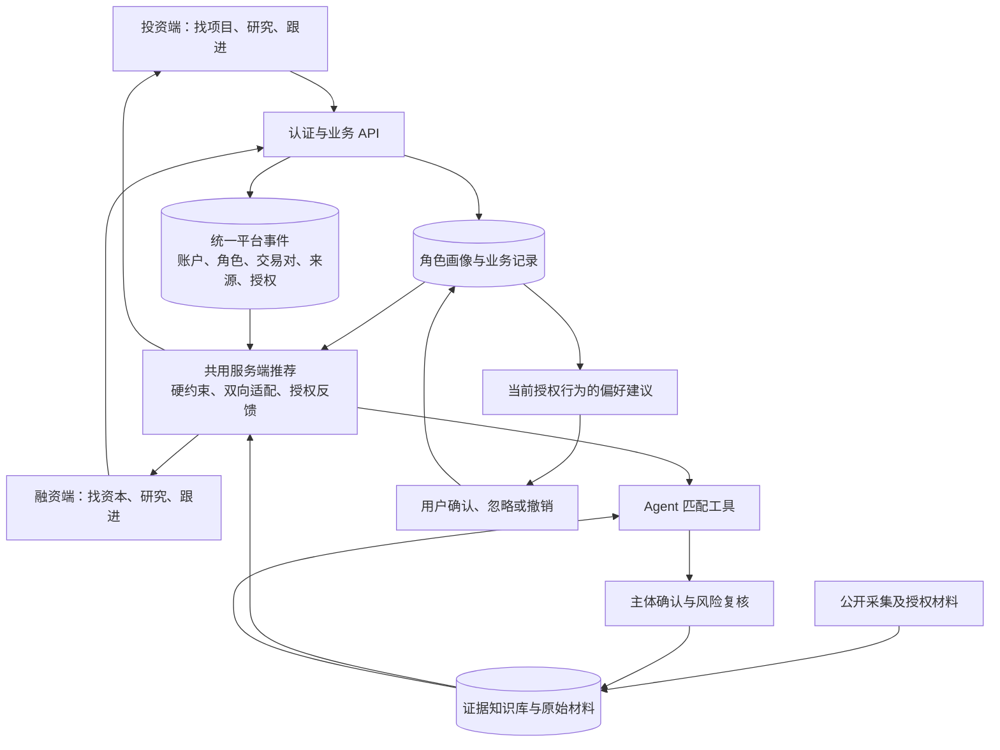

# FundLink 平台架构

数据飞轮是投资端与融资端共用的后台反馈机制。两端负责各自的业务动作，统一服务负责解释这些动作、保存有来源的事件，并把允许使用的反馈返回下一轮发现与研究。它不是某个角色的菜单页面。

## 当前实际链路

两端调用同一推荐服务，角色决定查询当前用户有权访问的哪部分画像、候选与反馈。主张、原文及上传文件继续保留在证据与文件权限层；平台事件不携带原始材料正文。

偏好建议目前由画像页面使用已保存的授权行为及同一套规则生成；用户确认后才写入明确偏好。推荐的实际排序由服务端统一生成。风险复核继续影响证据状态与研究待办，尚未训练自动校准风险规则的模型。

主要代码为 `lib/platform-flywheel.ts`、`lib/platform-flywheel-server.ts`、`lib/recommendation-server.ts`、`lib/recommendations.ts`、`app/api/recommendations/route.ts`，统一事件表在 `drizzle/0004_platform_flywheel.sql`。`/api/state` 保存时同步更新事件投影；推荐页和 Agent 调用同一服务，不各自维护另一套行为排序。

证据采集、复核和主体关联的元数据由服务端在读取推荐时同步到事件层，目前没有每次证据写入后的实时事件推送。原 `/api/flywheel` 保留有范围限制的 GET 诊断及 POST 评估保存，供兼容与内部检查使用；两个业务侧边栏均不展示它。

## 职责分层

| 层 | 当前职责 | 不承担的职责 |
|---|---|---|
| 双端业务界面 | 建档、发现、研究、收藏、反馈、业务跟进 | 不自行决定全平台学习权限 |
| 业务 API | 认证、角色范围、输入校验、版本控制、服务端时间及来源标注 | 不信任客户端声明的真实交易、授权时间或所属账户 |
| 统一事件层 | 以一致结构投影两端事件，保留企业与投资机构的固定方向、来源和可用范围 | 不因同名、网址相似或角色切换合并真实主体 |
| 共用推荐服务 | 从已保存状态、证据与授权事件生成双向匹配与排序 | 不以反馈绕过硬条件，不把分数解释成成交概率 |
| 证据与研究层 | 来源追溯、同主体联合研究、核查及复核、变化监测 | 不将弱关联当作同一主体，不将未核实披露变成事实 |
| 用户控制层 | 授权、撤回、清除、确认偏好及更正业务记录 | 不把个人行为直接变成基金授权 |
| 内部评估 | 检查留存窗口中的资料覆盖、复核、反馈及排序差异 | 不把当前账户指标当作全站运营成效 |

## 交易对与权限

所有事件中，交易对的逻辑方向固定为“企业—投资机构”；融资端和投资端只改变事件发起方。对象同时保留当前数据范围及来源，避免两个角色各自使用相反方向、无法接入同一处理逻辑。

目前工作区主体和公开发现线索没有跨账户实名认领关系。相同名称或相同公开网页不能证明两端用户代表同一企业/基金，也不能证明他们彼此有权访问资料。因此，当前生产路径中的交易对使用范围内标识，单侧登记保持单侧状态。真实的跨账户交易对需要经过认证的主体绑定与明确成员授权后才能连接。

统一基础设施不要求私有数据合并。任何跨客户复用都必须另有明确的数据来源、处理范围与授权，不从现有行为学习授权自动推出。

## 状态一致性

- 工作区保存采用版本检查；事件投影与工作区更新保持事务边界，失败一起回滚。
- 从旧版本读取时允许服务端补建当前投影，但不伪造历史业务结果或授权。
- 推荐读取持久化画像和受授权事件；撤回、清除及反馈删除必须影响后续读取。
- 学习采用去重、时间衰减、曝光校正及保守幅度；真实、自报、推断、模拟等来源始终区分。
- 内部诊断可以读取同一范围的历史快照，不能恢复被清除的行为参与学习。

## 后续产品能力

以下仍未接通，架构图中的共用服务不代表这些能力已实现：

1. 真实多用户认证、企业与基金认领、机构成员权限及基金授权管理。
2. 跨账户共享 Deal Room、对方独立确认、资料逐项授权和访问审计。
3. 外部邮件、日历、实际接洽/尽调/成交系统的授权回执。
4. 经另行许可的跨客户聚合评估与模型训练，以及证明推荐改善的实验体系。

当前可验证的是统一事件与推荐链路、权限隔离和可解释反馈规则。双边网络规模、真实合作转化与共享模型效果需要上述业务能力及真实样本支撑。
