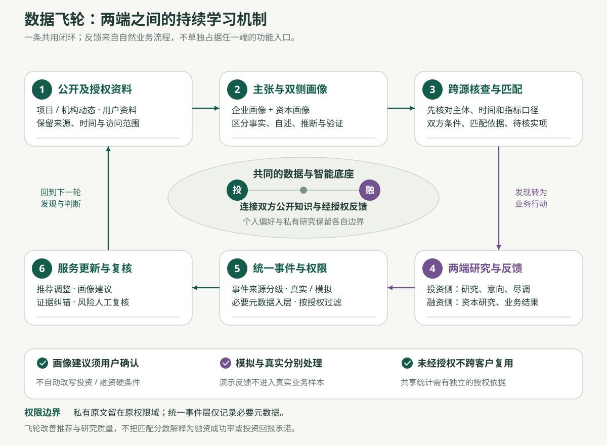
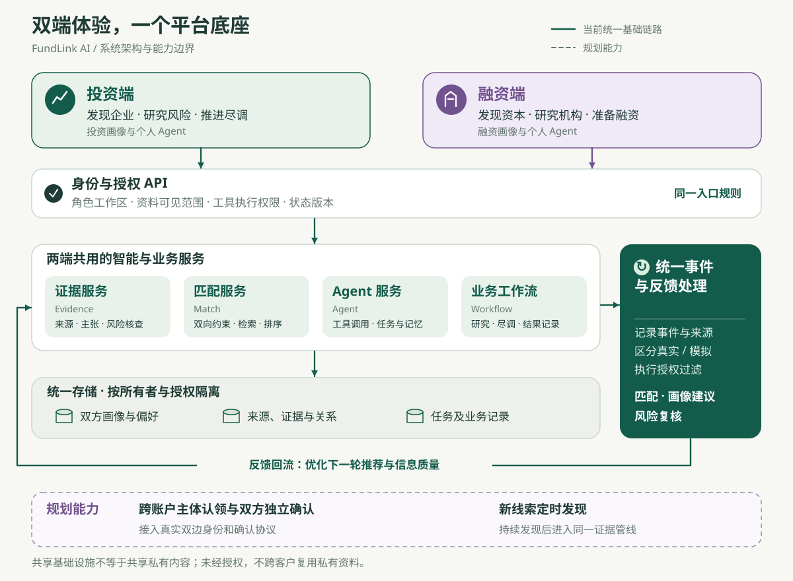

# FundLink AI｜产品设计、双端匹配与数据飞轮架构

版本 V1.1 · 2026-10-10

这份文档说明 FundLink AI 为什么这样设计、双方用户怎样使用、AI 在哪里创造价值，以及各模块如何形成持续改进的闭环。它同时给出完整产品目标与当前 Demo 的实际边界，供方案介绍、产品评审、开发协作和演示使用。

## 1 项目信息与体验入口

| 项目 | 内容 |
|---|---|
| 产品名称 | FundLink AI：双边智能投融资平台 |
| 一句话介绍 | 让企业拥有融资 Agent，让投资方拥有投资 Agent；通过共同的证据与匹配基础设施，把分散的信息转化为可研究的机会、可解释的判断和可跟进的行动。 |
| 服务对象 | 寻找项目的投资方，以及寻找适配资金和产业资源的企业、创业团队。 |
| 主要形态 | 一个网站，两类工作空间；首页选择“我要投资”或“我要融资”。 |
| 核心能力 | AI 建档、双边数据挖掘、证据知识库、跨源分析、双向匹配、可配置 Agent、业务反馈。 |
| 架构核心 | 数据飞轮位于平台共用的事件与反馈层，连接双方业务流程，不作为某一端的独立菜单。 |
| 当前阶段 | 可本地运行的功能型 Demo；包含真实工具链、规则计算与明确标识的模拟案例。 |
| 项目源码 | [GitHub 公开仓库](https://github.com/senizuaki-bit/fundlink-ai) |
| 本地体验 | 按仓库 README 启动后访问 http://127.0.0.1:5173；这是本机地址，不是供他人直接访问的线上体验链接。 |

**阅读建议。** 第 2—4 节解释产品思路与用户体验，第 5—11 节解释数据、算法和架构，第 12—15 节说明页面、实现边界、演示方式及后续建设。当前实现状态以第 13 节为准，前面的目标设计不意味着全部已经上线。

## 2 设计命题与核心判断

### 2.1 要解决的不是一次搜索，而是一段投融资工作

投资方通常面对大量分散线索：开源仓库、技术论文、企业官网、产品动态、招聘信息、融资新闻和企业提供的材料。问题不只在于找到这些信息，还在于判断它们是否属于同一主体、是否仍然有效、彼此能否比较，以及是否满足自己的投资条件。

融资方同样缺少信息。知道一家机构的名字，并不等于知道具体由哪支基金出资、当前投资什么阶段、单笔金额是否合适、能提供什么资源，或者是否存在竞品冲突。企业也可能尚未明确自身适合股权、产业资本、债务还是其他资金渠道。

FundLink 将这些工作组织为一条连续路径：明确需求，持续发现线索，形成有来源的画像，解释一致与不一致之处，比较双方条件，再把研究结果带入沟通和尽调。后续反馈回到共用处理层，帮助下一次发现和判断。

### 2.2 从招聘产品借鉴什么

借鉴的是降低使用门槛的方式：先选择角色，逐步补全资料，在首页查看推荐，表达兴趣或拒绝，换一批，再进入沟通。投融资本身仍需要更复杂的证据、授权和交易条件。

| 产品方式 | 能帮助用户完成什么 | FundLink 增加的工作 |
|---|---|---|
| 搜索引擎式检索 | 根据查询词找到网页和信息入口 | 把结果归入主体，保存来源、时间和主张，进行后续核查与持续跟进。 |
| 资料库式筛选 | 按已知字段筛出企业或机构 | 处理资料缺失、证据变化和公开线索，解释为什么适配或不适配。 |
| 招聘式推荐与沟通 | 降低建档、推荐浏览和联系门槛 | 同时考虑基金授权、融资需求、资本类型、资源诉求和信息共享边界。 |
| 通用聊天助手 | 回答问题、总结文字、起草内容 | 使用明确工具、当前主体证据、可回看的执行过程和经过确认的业务状态。 |

这里比较的是工作方式，不宣称所有搜索、招聘或金融产品缺少这些能力。FundLink 的设计重点是把这些步骤连成同一条有证据、可授权、可反馈的业务链路。

### 2.3 产品的四个基本判断

**先建立可用画像，再逐步变完整。** 初次使用不要求填写一份复杂金融表格。用户可以选“不确定”，由 AI 解释选项，再在真实研究和沟通过程中补全需求。

**发现线索与确认事实分开。** GitHub 仓库可能对应个人项目、技术团队或公司；公开融资新闻可能已经过期。平台可以推荐研究线索，但不能由此宣布公司正在融资、基金一定有钱可投，或当事人已经授权联系。

**适配、风险和证据分别表达。** 一个项目可以很符合策略，但证据尚不充分；一家基金可以有产业协同，但附带条款不合适。用户需要看到差异，而不是由单一“92%”替代判断。

**AI 建议与业务权威分开。** AI 可以解释、提问、起草和提出下一步；金额计算由确定性工具完成，授权由用户决定，真实对方同意和业务结果必须来自相应当事人或可信回执。

## 3 双端用户与完整旅程

### 3.1 谁在使用平台

投资侧首先服务于需要发现和研究项目的天使投资人、VC/PE 投资团队和产业投资团队。融资侧首先服务于需要明确资金需求、筛选资本及准备材料的创业者、企业融资负责人。银行、政策及科研资金等作为资本诊断方向逐步扩展，不假设不同资金类别使用相同的准入与决策规则。

“机构”“基金”“投资经理”在数据模型中需要分开。一家机构可以管理多支基金，基金的币种、阶段、存续期和投资授权可能不同；某位投资经理的个人兴趣不等于其所在基金的授权。公司、产品、开源项目和融资轮次也不能混成一个对象。

### 3.2 投资方旅程

用户选择“我要投资”，通过约十个维度说明投资方向和限制，获得初始画像与投资 Agent。进入工作台后，可以浏览推荐，也可以让 Agent 检索工业 AI、机器人等方向的公开线索。

一个开源项目进入雷达后，平台保存仓库、官网和相关材料，提示可能的主体关联，由用户核对后加入同一研究对象。投资 Agent 汇总产品、团队、商业化证据和资料缺口，说明匹配理由以及需要尽调的问题。用户收藏、拒绝或建立跟进记录，后续会谈和复核结果再用于下一轮研究与推荐。

### 3.3 融资方旅程

用户选择“我要融资”，说明公司阶段、现有现金、融资用途、目标金额及希望获得的资源。对资金类型尚不确定时，平台先协助比较研究方向，再生成企业画像和融资 Agent。

融资方在资本雷达中检索或导入基金官网、公告和公开投资案例，查看机构与具体资金载体的关系、偏好和待确认条件。融资 Agent 将企业的资金需求与基金条件进行双向比较，帮助用户整理优先接洽名单、沟通问题和材料清单。用户实际得到回复、会谈或条款后，记录结果与原因，持续修正融资策略。

### 3.4 匹配失败也应产生有用结果

“没有结果”需要解释原因。若金额区间没有交集，系统指出是哪项限制产生差异，并建议核实领投、跟投及联合融资安排；若证据不全，列出补充资料清单；若企业尚未明确资本类型，提供不同融资方式的研究路径。

系统不能为了凑出推荐而自动修改硬条件。例如“接受分阶段融资”“考虑另一币种”“放宽地域”都只能成为待用户确认的建议。暂时没有合适对象，也可以转为持续关注，等关键条件变化后重新评估。

## 4 AI 建档与渐进式画像

### 4.1 十个维度，而不是十道固定考试题

初次建档采用文字、选项与可编辑语音转写相结合的访谈。问题围绕十个维度组织，允许跳过和“不确定”；AI 根据已有回答解释概念、提供选项和有限追问，避免反复询问相同信息。目标设计逐步发展为动态问题树，当前 Demo 采用预设维度和有限追问。

| 维度 | 投资侧需要了解 | 融资侧需要了解 |
|---|---|---|
| 1 身份与主体 | 个人、机构、基金、当前角色与授权范围 | 公司、团队、产品以及填写人的角色 |
| 2 行业与问题 | 关注行业、明确排除的方向 | 服务什么客户、解决什么问题 |
| 3 发展阶段 | 种子、天使、Pre-A、A/B 轮或更成熟阶段 | 技术验证、产品验证、商业化或规模增长 |
| 4 金额与币种 | 单笔出资区间、币种、领投或跟投 | 本轮融资总额、可接受单笔金额、币种 |
| 5 地域范围 | 投资授权地域与实际资源覆盖 | 注册地、业务地区及未来拓展计划 |
| 6 商业与财务 | 对收入、客户、增长或技术验证的要求 | 当前收入、回款、现金和净消耗的口径 |
| 7 核心目标 | 财务回报、战略协同及投资重点 | 资金用途、业务里程碑和融资时间窗口 |
| 8 资源供需 | 能提供的产业客户、渠道、技术或供应链 | 希望资本提供的资源及优先顺序 |
| 9 合作条件 | 投资角色、治理偏好、资料及流程要求 | 稀释、控制权、排他、竞品等边界 |
| 10 不确定与授权 | 尚未确定的偏好、Agent 可用工具 | 尚未确定的条件、材料可见范围与工具权限 |

问题不是金融适当性测评，也不借此出具专业资格或风险承受等级认定。它的作用是建立可用于发现和研究的业务画像。

### 4.2 输入、解释、抽取、确认

例如融资用户说：“我们做工厂设备的预测维护，已经有几个付费客户，想融三千万，最好能带来产业客户。”系统先保留原文，再提出行业、客户状态、金额和资源需求的候选字段。币种、融资轮次和单笔接受范围没有明确说明时继续保留未知。

语音转写必须先允许用户编辑；金额、币种、日期、主体名和限制条件需要显式核对。抽取结果由用户选择采用，不能因为模型给出了结构化 JSON 就直接视为已确认事实。

### 4.3 四层画像与字段来源

| 画像层 | 保存什么 | 如何更新 |
|---|---|---|
| 用户自述事实 | 用户填写的公司、产品、资金等信息 | 保留原文、更新时间、填写身份和修订记录。 |
| 明确偏好与约束 | 行业、阶段、金额、资源和排除条件 | 用户直接修改或确认建议后更新；硬约束优先。 |
| 推断偏好 | 授权行为支持的兴趣变化假设 | 保存依据与适用范围，等待确认；不能覆盖基金授权。 |
| 有证据支持的信息 | 官网、公告或私有材料支持的字段 | 关联具体来源、时间和核验状态；材料自述不自动变成独立验证。 |

注册完成后，企业可继续补充 BP、财务、股权、客户与产品资料；投资方可补充具体基金信息、策略、历史投资和资源能力。遇到研究阻塞时，Agent 只追问当前最有用的缺口，这就是渐进式画像完善。

## 5 双边数据挖掘与证据知识库

### 5.1 双端都需要主动发现

| 发现对象 | 主要来源 | 可提取的信号 | 不能直接推出的结论 |
|---|---|---|---|
| 技术项目与团队 | GitHub、Hugging Face、arXiv | 产品方向、维护活动、贡献者、论文与模型信息 | 仓库热度不能证明收入、产权归属或融资意愿。 |
| 企业业务 | 官网、产品页、招聘页、公开公告 | 产品定位、目标市场、岗位需求、业务进展 | 招聘增加不等于收入增长，官网宣传不等于核验事实。 |
| 投资机构与具体基金 | 基金官网、投资公告、公开组合、新闻 | 行业与阶段偏好、历史出资、产业资源线索 | 历史投资不能证明当前仍有额度或接受新项目。 |
| 交易及经营材料 | 用户授权的 BP、报表、合同摘要和纪要 | 融资需求、经营指标、条款与进展 | 上传方自述不能替代独立审计，也不自动授权对外共享。 |

第一版应优先使用明确来源的 API、公开网页和用户授权材料，逐步扩充覆盖。数据采集遵循来源访问条件、速率限制和授权范围；没有可用来源时显示缺口，不通过生成内容补齐事实。

### 5.2 从检索结果到可研究对象

采集流程依次完成任务定义、工具检索、原文保留、字段抽取、候选去重、主体关联、入库和质量检查。每条记录至少保留来源地址或文件标识、采集时间、原文片段、数据类型以及当前可见范围。

主体关联先产生候选关系。例如仓库 README 指向某官网，可以成为同主体候选依据；多个名称相似的公司不能直接合并。当前 Demo 由用户确认关联后开展联合研究；目标平台进一步加入权威标识、企业认领和成员授权。

转载文章不能被当作多个独立证据。平台要区分原始披露、转载、引用和独立观察，同时处理 URL 重复、页面版本变化及失效链接。保留来源发生变化的时间，避免用新资料覆盖历史判断所依据的旧版本。

### 5.3 定时发现与定时监测是两条任务链

**新线索发现任务。** 用户订阅“工业 AI、最近新增仓库、符合某些公开条件”等主题，调度器周期调用检索工具，使用游标和去重规则识别新对象，进入待研究队列。融资端对应机构、基金和投资动态的新线索。这是目标设计，当前 Demo 尚未实现周期性新对象发现。

**已有对象变化监测。** 对用户关注的企业或基金，重读已有公开来源，比较版本，记录关键变化，再触发研究或待办。当前 Demo 已支持本地进程运行期间的定时巡检。云端持续调度、系统通知及长期运行保障需要后续接入。

AI 负责生成和细化检索计划、解释结果；调度器负责时间、重试和去重，不能依赖聊天模型“记得过几小时再来”。

### 5.4 知识库的基本组织方式

知识库将“主体—来源—主张—关系—发现—复核”连接起来。主张不是一段脱离来源的摘要，而是包含主体、指标、数值、单位、币种、期间、范围和原文引用的记录。

目标架构区分公共事实索引、机构内部研究资料和交易授权资料。当前 Demo 的知识数据按账户与角色隔离，并未建立一个可以跨客户任意复用的公共大库。删除私有材料时，应同步撤回由该材料生成的派生证据，避免正文已删但推断仍继续被使用。

## 6 跨源分析与风险提示

### 6.1 AI 分析的核心是先判断能不能比较

跨源分析首先核对六件事：是否同一主体、是否同一指标定义、是否同一期间、是否同一业务范围、是否同一计量单位，以及是否同一币种。只要口径无法对齐，系统应说明“不直接可比”或“资料不足”，而不是直接给出差异百分比和负面结论。

在此基础上，规则识别可计算的差异，AI 整理可能解释、反证需求和待核实问题。解释需要绑定来源，不能把推测写成企业事实。人工复核补充结论与理由，新证据到来后可以重新检查。

### 6.2 贯穿演示的案例：ARR 与营业收入

假设某模拟企业在 2026 年 9 月的商业资料中写“ARR 为 1,200 万元”，另一份资料写“2025 年营业收入为 400 万元”。平台应指出：ARR 是某时点的经常性收入年化口径，营业收入是一个会计期间的确认值；两者期间和定义均不相同。

正确输出是核验问题：ARR 是否仅包含经常性合同，是否包含未生效订单，2025 年收入确认范围是什么，以及两个时间点之间是否有新增客户。可以提出增长、口径变化或资料错误等解释候选，但不能据此认定欺诈，也不能用它证明企业已经实现三倍收入增长。

### 6.3 两端的风险关注点不同

| 投资方研究企业 | 融资方研究资本 |
|---|---|
| 收入、回款与合同口径是否一致 | 投资主体、基金载体与决策授权是否明确 |
| 客户集中、续约和商业化证据是否充分 | 当前投资阶段、额度和时间窗口是否真实可用 |
| 技术主张、开源许可与知识产权归属 | 产业资源承诺是否有案例、负责人和兑现条件 |
| 团队、产品稳定性与关键人员依赖 | 已投竞品、信息隔离与保密安排 |
| 现金消耗、资金用途和后续融资空间 | 控制权、稀释、排他及退出安排是否符合企业边界 |

风险卡应包含发现、支持及反对证据、可能解释、资料缺口、建议动作和复核状态。状态可为待核实、已解释、已验证、误报或无法确认；人工点击“已验证”表示用户记录了复核结论，不表示平台完成独立审计。

风险提示用于安排核查优先级。具有重大法律或交易后果的判断应交由适当的专业人员及双方决策流程处理，产品不把风险卡自动变成信用评级、法律结论或拒绝交易的决定。

## 7 双向匹配与推荐算法

### 7.1 为什么需要两个方向

投资方关心“这个项目是否符合我的策略和条件”；融资方关心“这类资金、资源与合作条件是否适合我”。只计算投资人喜欢什么，会把企业的时间、稀释和战略诉求降为次要因素。

因此，每一对企业与资本至少有两个适配分：InvestorFit 与 FounderFit。当前 Demo 基于当前账户的画像与可见候选资料计算这两个方向，不能将其理解为另一个真实用户已经表达了意愿。

### 7.2 五步推荐流程

1. **读取授权范围。** 使用已经保存的画像、当前可见证据和允许学习的事件，记录输入版本。
2. **核对硬条件。** 检查行业、阶段、地域、币种、金额相容性、资本类型、合作角色、排除条件及身份资料。已知不符与未知分别处理。
3. **检索与召回。** 对符合权限的对象进行关键词和概念关联检索，扩展同义表达，再形成候选集。
4. **双向评分与重排。** 分别计算两侧适配，叠加有界反馈及来源因素，控制同质化。
5. **生成解释。** 返回条件、理由、证据、资料缺口和下一步；保留所用版本，供后续复核。

未通过正常筛选的对象可以进入“探索与待确认”，但不能通过提高语义相似度绕过硬条件。融资总额和单笔投资额需要分别建模：基金只投一部分并不一定不适配，但是否允许跟投、联合融资和分阶段融资必须由企业条件决定。

### 7.3 当前 Demo 的可解释评分

| 方向 | 维度与默认权重 |
|---|---|
| 投资方适配 | 投资策略与行业 35%；阶段 20%；单笔范围 20%；明确投资重点 15%；地域授权 10%。 |
| 融资方适配 | 企业需要的资源 40%；资金需求覆盖 30%；合作与投资角色 15%；融资方式 15%。 |
| 双向参考分 | PairScore =（InvestorFit + FounderFit）÷ 2。 |

上述权重是当前规则版本的产品假设，不是通过历史成交数据校准的金融预测模型。证据不足时显示暂估或未知；平均分不能掩盖任一硬条件不满足。

当前混合检索以关键词分词、人工概念词典、同义词和概念向量相似度实现，检索参考分为 55% 关键词分与 45% 概念关联分。当前排序在 PairScore 基础上轻量加入检索分、证据质量和新鲜度，再对重复行业与地域施加多样性调整。界面不把内部排序分显示为成交概率。

后续在数据量和评估集足够时，可以接入专用 embedding、向量检索、重排模型或学习排序；先保留规则版本和解释，再检验是否优于现有基线，不能仅凭模型复杂度判断算法更好。

### 7.4 刷新、冷启动与反馈

“换一批”保留已展示记录并取后续候选；用户明确选择重新浏览时才重置。新用户主要依靠明确画像和证据，低样本用户不强行生成行为偏好。探索推荐也应在授权与条件边界内运行。

授权行为按对象和类型去重，采用时间窗口、时间衰减与曝光校正。当前规则只允许有限幅度的行为调整，弱浏览不会自动改写行业策略。无点击可能只是没看到、没时间或缺乏材料，不能直接解释为否定。

## 8 可配置的个人投融资 Agent

### 8.1 Agent 是业务工作环境

用户的 Agent 由五部分组成：基础画像、长期目标、工具权限、当前任务和可控制的对话上下文。投资方可让它偏重技术、商业化或产业协同，融资方可让它偏重资金规划、资本筛选和沟通准备。

两端 Agent 使用相同的平台服务，但任务目标和允许读取的资料不同。当前产品支持名称、目标及工具开关；用户自由编排复杂工作流和 Agent 间自主谈判属于后续能力。

### 8.2 一次任务如何执行

以“研究这家公司，核对收入披露，并整理首次会谈的问题”为例：Agent 先识别任务对象和权限，再调用证据检索、主体关系、跨源核查及匹配服务；必要时根据明确请求调用公开检索。最终回答说明已执行工具、实际找到的来源、不能确认的内容，以及下一步问题。

模型没有调用成功的工具，不能在回答里声称已经完成采集或发送。财务追问只继承用户明确给出的数字和单位；历史助理文本不是事实来源，也不能作为新一轮外发授权。不同对象的对话上下文应隔离，用户可以关闭本轮历史使用。

### 8.3 工具与行动权限

| 能力 | 用户得到什么 | 控制方式 |
|---|---|---|
| 公开搜索与入库 | 有 URL、时间和主张的研究线索 | 限定来源、任务与访问范围；记录成功与失败。 |
| 私有证据研究 | 根据本人授权材料生成的分析 | 明确工具开关及材料权限，不向未授权对象披露。 |
| 匹配与公式计算 | 同一服务端结果、可复核数值 | 规则执行、单位检查，模型负责解释结果。 |
| 画像修改建议 | 从明确要求或授权反馈产生的候选修改 | 显示前后值、理由与范围，由用户确认。 |
| 沟通草稿 | 面向具体对象的可编辑内容 | 先预览；真实发送需接入渠道并取得具体确认。 |
| 共享、签署及资金操作 | 目标产品中的受控交易行动 | 权限和逐次确认独立设计；当前 Demo 未接通。 |

外部网页和上传材料都作为待分析内容，其中的指令不能改变工具权限。模型服务失败时应显示失败；规则工具仍可继续使用，但必须清楚标识输出来源。

## 9 金融工具与业务推进

### 9.1 先明确融资用途，再比较资本类型

企业的需求通常包含资金规模、使用期限、经营里程碑和希望得到的资源。系统先把这些要求讲清楚，再比较天使/种子资本、VC/成长基金、CVC/产业资本、PE/成熟股权资本、债务资金以及政策/科研资金等研究方向。

资本诊断返回“可优先研究、条件待确认或当前假设不适配”，并列出需要核实的条件。例如不接受股权稀释时，需要先核对股权资本是否符合要求；没有明确偿债来源时，不能仅因不想稀释就将债务融资推荐为最优选择。政策资金的资格、用途、验收和拨付条件必须针对具体项目核查。

### 9.2 基础计算与情景假设

| 工具 | 简化计算 | 必须说明的假设 |
|---|---|---|
| 现金续航 Runway | 可用现金 ÷ 每月净现金消耗 | 净消耗大于零且保持稳定，不是完整现金流预测。 |
| 新增资金需求 | max（0，月净消耗 × 目标月数 + 缓冲 − 可用现金） | 基于静态情景；另行审视一次性投入、收入变化和拨付时点。 |
| 投后估值 | 投前估值 + 本轮新股融资额 | 简化的新股现金融资情景，不含复杂可转债和其他权利。 |
| 新投资人占比 | 本轮新股融资额 ÷ 投后估值 | 没有其他稀释因素时成立；期权池等需单独建模。 |
| 毛利率 |（同期间营业收入 − 营业成本）÷ 营业收入 | 主体、期间、范围及会计口径一致，收入大于零。 |
| MOIC | 回收金额 ÷ 已投资本 | 不反映时间价值，不能替代 IRR，估值变化不等于现金回收。 |

所有计算使用同一币种和金额单位，缺失或含糊输入先确认。示例：现金 300 万元、月净消耗 50 万元，静态续航为 6 个月；该结果不代表未来一定能经营 6 个月。股权表需要原股东占比合计 100%，并区分新增期权池由原股东承担还是融资后共同承担的假设。

### 9.3 从研究到交易跟进

目标工作流依次覆盖研究、意向沟通、双方独立确认、会谈、尽调、条款、决策与关闭。每一步都有主体、负责人、时间、待办、来源和状态，避免聊天结束后工作记录散落。

当前交易工作台用于模拟流程体验；实际发生的回复、会谈、尽调或结果可以单独登记为“用户自报”。这两类记录分别存储和标识。外发邮件、对方独立确认、跨账户共享空间、电子签署和支付都不能靠点击模拟按钮变成真实动作。

平台还应保存暂不推进的结构化原因，例如时机、金额、阶段、资源、冲突、材料或条件差异。原因用于改善后续工作，而不是形成无依据的负面企业标签。

## 10 连接双端的数据飞轮

### 10.1 飞轮在架构中，而不在任何一端的菜单里

投资方和融资方分别开展业务，平台将其产生的信息转成具有统一含义、来源及授权范围的事件，再回到下一轮画像建议、匹配与研究。这是双方共享的一条基础链路：数据输入 → 证据与画像 → 分析和匹配 → 研究及业务反馈 → 统一事件与复核 → 更新后续判断。

用户不需要点击“运行数据飞轮”。他在正常使用中完成查看、收藏、拒绝、复核和业务登记；授权设置放在画像中，结果反馈放在业务流程中，内部质量评估由平台承担。

### 10.2 两类反馈共同改善下一轮工作

**匹配反馈链。** 用户明确条件、授权行为与业务阶段反馈，帮助平台判断什么值得继续研究、何时追问缺失条件，以及哪些方向需要用户重新确认。两端都提供反馈，但只在各自的授权范围内使用。

**证据反馈链。** 主体关联确认、来源变化、指标口径补充和风险复核，改善同一主体的知识与后续研究。一个问题被解释后应能看到原因，新证据推翻原解释时也应允许重新打开，而不是永久固化旧结论。

目标平台可以在另行许可、具有足够样本和评估机制的前提下，形成聚合层面的来源质量与匹配策略改进。当前已经实现规则反馈和统一事件底座，尚未完成跨客户共同训练或验证网络效应。

### 10.3 事件要说明“谁做了什么，依据是什么”

| 信息 | 设计用途 |
|---|---|
| 事件 ID、类型和时间 | 去重、重放、排序，并区分业务发生时间与录入时间。 |
| 账户、角色及权限范围 | 判断谁能读取、谁允许用于学习，避免跨客户越权。 |
| 企业键、投资机构键 | 固定“企业—资本”的方向，避免两端以不同顺序描述同一交易对。 |
| 对象、来源事件和版本 | 回到原始业务记录，检测编辑、删除与过期投影。 |
| 来源性质 | 区分观察、用户自报、双方独立确认和模拟；不能互相冒充。 |
| 学习授权及可用状态 | 撤回、清除或来源删除后停止使用相应派生信息。 |

统一事件只保留处理所需的元数据，私有 BP 正文、业务备注和敏感证据原文仍在原有权限层。相同名称或网址不自动建立跨账户身份绑定；真实的双边桥梁需要企业/机构认领、成员权限和双方确认。

### 10.4 如何避免“越用越偏”

当前个性化默认关闭。用户主动授权后，仅使用符合本次授权时间范围的行为，保留近 90 天窗口，按 30 天半衰期降低旧信号权重；同一对象和信号类型去重，并按曝光进行校正。

浏览、搜索、换批属于弱证据，只轻微影响当前对象，不足以独立生成新行业偏好。多个独立对象的中强反馈达到门槛后才提出偏好建议，仍需用户确认。当前行为调整范围为单侧 −3 至 +6 分，不能改变硬条件；模拟案例与真实来源分别计算。

一次未回复或暂不推进不能被简单视为项目质量差；可能存在排期、资金周期、材料缺失或业务时机等原因。业务结果要考虑反馈滞后和样本选择偏差，不能把单侧自报“成交”当作平台已核实交易。

### 10.5 飞轮是否有效，需要什么证据

记录变多并不自动证明推荐变好。需要观察在相近条件和明确版本下，研究耗时是否减少、适配解释是否有用、缺失信息是否被补齐、错误关联及风险误报是否下降，以及有效回复、会谈和下一步推进是否改善。

后续实验应固定评估口径，分别衡量双方收益、保留探索样本和未反馈样本，按行业与阶段观察偏差。当前内部排序对照只能展示反馈改变了结果，不能证明因果改善或融资成功率提升。

## 11 系统架构与数据模型

### 11.1 平台共用服务与双端业务界面

双端网站通过认证与权限边界进入共用服务。采集服务负责取得并保留数据，证据服务负责主体、来源、主张和核查，推荐服务负责条件与排序，Agent 负责受控工具编排，业务工作流负责真实可记录的状态变化。事件与反馈层连接这些服务，不能由某个页面各自维护一套相互冲突的学习结果。

当前发现列表、详情和 Agent 通过同一后端推荐服务获取匹配依据。该服务读取已保存的工作区与授权事件投影，响应中带有工作区版本；如果读取期间画像或授权发生变化，返回冲突并重新获取，不回退到浏览器中的旧行为排序。

### 11.2 核心数据对象

| 对象 | 关键内容及关系 |
|---|---|
| 用户、组织与成员 | 用户属于哪些组织、可代表什么主体、能使用哪些基金权限；真实组织模型属于后续建设。 |
| 公司、项目与产品 | 公司和技术线索分开，记录确认后的主体关系。 |
| 机构、基金与授权 | 机构管理具体基金，基金记录币种、范围、期限与投资条件。 |
| 画像与版本 | 自述、明确约束、推断建议、证据支持及历史修改。 |
| 来源与主张 | 原文、出处、时间、指标口径、单位、币种、引用关系。 |
| 发现与复核 | 差异、解释候选、待核实问题、人工结论和依据。 |
| 推荐与检索结果 | 候选集、规则版本、两个方向分数、解释及状态版本。 |
| Agent 任务与上下文 | 当前对象、工具轨迹、受限历史、来源引用和待确认修改。 |
| 跟进记录与业务结果 | 阶段、任务、纪要、资料权限、自报或回执来源。 |
| 平台事件与投影 | 统一方向、事件来源、授权过滤及反馈派生状态。 |

这是一套目标领域模型。当前 Demo 用工作区和证据表实现其中主要链路，尚未把所有概念拆成独立的生产级服务或全局实体表。

### 11.3 当前技术实现与演进方向

当前网站使用 React 与 TypeScript，基于 Vinext/Vite 运行，服务接口承担认证范围、输入校验和版本控制；结构化数据使用 D1，文件使用 R2 的本地开发环境。模型适配层支持配置 DeepSeek，新闻搜索等工具依赖各自配置。模型密钥只放在服务端环境变量中，不进入前端或公开仓库。

主要链路包括 `/api/state` 保存状态，`/api/knowledge` 采集及研究证据，`/api/recommendations` 返回统一推荐，`/api/agent` 执行工具任务，以及 `/api/watch-schedule` 管理本地巡检。状态保存与工作区事件投影在同一事务中更新；证据元数据目前在读取推荐时同步，并非所有证据写入都已接入实时消息队列。

面向持续运行的平台，可逐步引入任务队列、云端调度、公共主体解析、按权限检索、对象存储生命周期、监控告警和审计记录。新线索发现与已有对象监测使用不同任务类型，失败重试、幂等键和成本限制由程序保证。

### 11.4 权限和数据生命周期

产品需要同时区分公开资料、当前账户私有资料、组织授权资料和具体交易授权资料。关闭 Agent 的私有知识工具后，不应继续把该部分材料带入模型上下文；删除文件后应清理派生主张；撤回行为学习后停止相应排序影响。

共享事件基础设施不等于公开数据仓库。跨账户主体连接、资料共享和聚合学习分别具有独立权限，不能从“开启个性化推荐”推导出用户同意将尽调材料用于其他客户。

## 12 页面与功能设计

| 页面 | 投资端 | 融资端 |
|---|---|---|
| 首页 | 选择“我要投资”，进入引导建档或投资空间 | 选择“我要融资”，进入引导建档或融资空间 |
| 发现机会 | 企业与项目卡片、匹配解释、探索候选、搜索和换批 | 基金与资本卡片、资源适配、条件缺口、搜索和换批 |
| 雷达 | 项目雷达：技术平台与企业公开线索 | 资本雷达：基金官网、公告、投资与资本动态 |
| 收藏 | 保存待研究项目 | 保存待接洽资金和机构 |
| 证据知识库 | 核对企业来源、主张、主体关系与发现 | 核对机构来源、策略、资源和待确认条件 |
| 动态监测 | 关注企业的公开资料变化 | 关注资本与机构的公开资料变化 |
| 我的 Agent | 项目研究、对比、核查、计算和草稿 | 融资策略、资本研究、材料准备和草稿 |
| 交易工作台 | 沟通与尽调、待办、阶段、自报反馈 | 接洽与材料、待办、阶段、自报反馈 |
| 专业工具 | 研究框架、回报情景、资本与财务分析 | 资金需求、续航、稀释、股权情景及资本诊断 |
| 我的画像与资料 | 画像、材料、推荐偏好、数据管理 | 画像、材料、推荐偏好、数据管理 |

两端采用不同侧边栏配色，帮助用户确认当前身份；整体布局、术语和交互保持一致。数据飞轮不占据一个用户菜单，它通过各业务页面自然产生的数据在后台运转。

卡片首先回答四件事：这是谁，为什么出现在这里，依据是什么，下一步做什么。来源与日期应能继续展开，未知条件应可见，操作按钮优先支持研究、保存、反馈和明确的下一步，不以高分诱导直接进行交易。

## 13 当前实现与演示边界

下表基于 2026-10-10 本地源码和已有验收记录整理。“已实现”指存在可执行的本地链路，不等于生产平台、真实数据覆盖或专业判断质量已经全面验收。

| 能力 | 当前状态 | 准确边界 |
|---|---|---|
| 双端入口、画像与资料 | 已实现 | 十维引导、后续专业字段、来源与修改历史；复杂动态访谈仍可扩展。 |
| 语音输入 | 局部支持 | 依赖浏览器 SpeechRecognition；不支持的环境可继续使用文字。 |
| 投资侧公开项目挖掘 | 已实现基础链路 | GitHub、Hugging Face、arXiv 等按次检索，结果入库；不代表全网持续覆盖。 |
| 融资侧资本挖掘 | 局部支持 | 官网与公告导入、基金和新闻检索入口；新闻搜索需配置 Brave，机构实时额度待核实。 |
| 定时发现新项目或新机构 | 规划中 | 需要关键词订阅、增量发现队列和持续调度。 |
| 已有主体来源巡检 | 已实现本地版本 | 对关注主体的已知公开网址运行；本地进程关闭或电脑休眠期间不执行。 |
| 证据知识库与材料解析 | 已实现基础链路 | 文本 PDF 及常见文本格式；扫描件 OCR、复杂表格理解待补充。 |
| 跨源核查与风险复核 | 已实现规则底座 | 有引用、口径检查和人工复核；不等于自动财务审计或欺诈判定。 |
| 统一双向匹配 | 已实现 | 硬条件、双向参考分、人工概念检索、反馈与多样性；未训练专属金融 embedding。 |
| 工具型 Agent | 已实现受限版本 | 真实工具执行、上下文和引用；外部服务受配置、权限和可用性限制。 |
| 金融计算 | 已实现基础工具 | 简化公式、股权情景和尽调框架；不是完整估值或审计系统。 |
| 沟通与尽调工作台 | 模拟流程已实现 | 双方确认、发送和共享采用明确模拟标识。 |
| 实际业务结果登记 | 已实现单侧自报 | 有时间、说明和来源，不冒充对方确认或已核实成交。 |
| 平台事件与数据飞轮 | 共用底座已实现 | 授权事件进入服务端推荐；真实主体键仍限定于账户与角色范围。 |
| 跨账户双边协作 | 规划中 | 真实主体认领、组织权限、双方独立确认和共享 Deal Room 尚未接通。 |
| 全平台共同训练与效果实验 | 规划中 | 当前保留局部诊断，不宣称已经证明网络效应或提升融资成功率。 |

开发验证覆盖类型检查、离线测试、构建以及关键浏览器流程；代码中的 SQLite 测试检查状态与事件事务、账户/角色隔离、撤回授权、版本冲突和统一推荐。具体命令及范围见仓库 `docs/PRD_IMPLEMENTATION.md`。这些工程测试证明规则按预期执行，不替代真实用户试用和金融分析质量评估。

## 14 演示故事线与验证指标

### 14.1 用一组对象讲清整个链路

建议用模拟企业 IndustrialMind AI 和模拟投资机构贯穿约五分钟演示，同时单独展示一条实际采集的公开技术线索。两者始终保留来源标识，不暗示模拟企业就是该公开项目的真实经营主体。

| 环节 | 演示动作 | 要让观众看到的价值 |
|---|---|---|
| 0:00—0:45 双侧建档 | 分别选择身份，输入自述，确认抽取字段 | 不懂专业术语也能形成可用画像；未知不被随意补齐。 |
| 0:45—1:30 主动发现 | 从项目雷达检索公开线索，展示融资侧资本导入路径 | 双端都可以挖掘信息，数据有来源和采集时间。 |
| 1:30—2:20 证据分析 | 打开 ARR 与营业收入的模拟案例 | AI 解释口径差异、列出核验问题，而非直接判定造假。 |
| 2:20—3:10 双向匹配 | 查看两方向评分、硬条件、资源及缺失信息 | 推荐兼顾资本与企业，不把热度直接当成投资价值。 |
| 3:10—4:10 Agent 与工具 | 执行研究任务和有明确单位的现金计算，准备沟通草稿 | 工具真实运行、计算可核对、来源可追溯、动作可控制。 |
| 4:10—5:00 反馈闭环 | 用专用演示数据展示授权、反馈和下一轮结果 | 后台统一事件影响后续推荐，硬条件不变，模拟数据不混入真实记录。 |

不要在真实用户工作区为了演示而捏造会谈或成交。演示反馈应放在明确标识的测试数据中，或由用户登记确实发生的业务。若外部检索不可用，可展示带采集时间的历史结果并说明状态，不能将缓存或案例说成刚刚实时检索成功。

### 14.2 验收应观察什么

| 目标 | 建议指标 | 解释边界 |
|---|---|---|
| 建档有效 | 完成时间、关键字段确认率、后续修订率 | 快速填完不代表画像真实或完整。 |
| 发现质量 | 新增有效主体数、来源可访问率、重复率、资料新鲜度 | 以去重主体和明确定义为分母，不用网页条数冒充机会数。 |
| 分析可信 | 引用可追溯率、口径识别正确率、误报及复核耗时 | 需要标注样本或人工复核，不能自评为准确率。 |
| 匹配有效 | 双侧认为值得研究的比例、理由有用性、补充资料完成率 | 分开看双方收益，避免只有投资侧点击率。 |
| 业务推进 | 回复、会谈、尽调等阶段到达率及耗时 | 区分单侧自报与独立回执，观察反馈滞后。 |
| Agent 有用 | 任务完成率、证据覆盖、工具失败率、节省时间 | 以可复核任务与基线比较，不能由回答长度推断价值。 |
| 反馈改善 | 固定规则版本的排序对照、后续实验差异 | 排名变化只是机制生效，因果收益需另行设计实验。 |

初期可以招募少量真实投资和融资用户，在一致任务上记录手工流程与使用系统的时间、资料缺口和判断变化，再依据反馈修正问题树和解释方式。这里给出的是验证计划，没有填入未经测量的提升百分比。

## 15 建设路线与产品价值

### 15.1 按完整业务链路分阶段建设

| 阶段 | 重点建设 | 完成判断 |
|---|---|---|
| 阶段 A：可解释 Demo | 双端建档、公开发现、证据核查、双向匹配、工具 Agent、统一反馈底座 | 用户能看懂从来源到建议的过程；当前已具备主要本地链路。 |
| 阶段 B：可持续情报 | 新线索定时发现、云端调度、增量任务、来源质量与成本监控 | 新机会能持续进入，失败可重试、重复可控、来源可追溯。 |
| 阶段 C：真实双边协作 | 正式认证、公司/基金认领、成员权限、独立意向、共享 Deal Room | 两个真实主体在各自授权下完成同一条协作记录。 |
| 阶段 D：受控外部行动 | 邮件、日历、资料授权和可信业务回执 | 每次行动有具体授权、执行结果、审计及失败处理。 |
| 阶段 E：可验证优化 | 真实样本评估、聚合许可、探索实验与学习排序 | 以预定义指标证明有益改进，再扩大使用范围。 |

这一顺序先保证链路可解释，再保证持续供给与真实双边参与，最后讨论更复杂的模型训练。数据量、真实性和反馈质量不足时，继续堆叠模型不会自动形成有效飞轮。

### 15.2 价值与商业假设

对投资方，价值在于减少分散检索和重复整理，将研究时间集中在证据与判断；对融资方，价值在于更清楚地认识资金需求，找到更适配的资本，并提高沟通准备质量。对平台，长期可积累的是有来源的主体知识、双方需求变化与经授权的业务反馈，而不是一份越长越好的机构名单。

可探索个人研究订阅、团队协作席位、情报监测与机构知识库等商业模式；定价和付费意愿需要真实试用验证。推荐排序与商业推广需要明确分开，不能让付费曝光伪装成更高适配。交易佣金等模式应在具体业务与适用要求明确后单独论证，不作为当前 Demo 已成立的收入假设。

最值得验证的产品判断是：当发现、分析、匹配和跟进使用同一份有来源的上下文，双方是否能够更快明确“是否值得继续、缺什么、下一步由谁做”。这比单纯追求候选数量或聊天频次更贴近用户的实际工作。

## 16 设计依据与项目资料

本方案根据用户最初提出的双端数据挖掘、跨源分析、招聘式匹配、十维 AI 建档、个人 Agent 和数据飞轮思路整理，结合原始 PRD 与当前代码做了结构调整。数据飞轮按共用平台机制描述，纠正将其作为某一端功能页的表达。

| 资料 | 用途 |
|---|---|
| [GitHub 项目仓库](https://github.com/senizuaki-bit/fundlink-ai) | 源码、配置示例、启动说明及测试入口。 |
| [本设计文档源码](https://github.com/senizuaki-bit/fundlink-ai/blob/main/docs/PRODUCT_DESIGN.md) | 可修改、可追踪版本的完整方案。 |
| 仓库 docs/FundLink_AI_PRD_V1.0.md | 用户原始完整产品方案归档，保留初始需求。 |
| 仓库 docs/PLATFORM_ARCHITECTURE.md | 当前共享事件、推荐服务、权限与状态一致性设计。 |
| 仓库 docs/DATA_FLYWHEEL.md | 授权、学习规则、事件闭环与当前边界。 |
| 仓库 docs/PRD_IMPLEMENTATION.md | 模块实现、验收命令与未完成能力。 |
| 用户提供的飞书示例（原链接不随公开源码分发） | 参考“方案信息、场景、具体设计、架构、验证与路线图”的讲述方式；不作为 FundLink 实现或金融结论的证据。 |

**公开仓库的范围。** 提供项目源码和演示材料，排除模型密钥、本地数据库、上传文件、私人工作记录和旧运行环境。首次使用者需要自行安装依赖、初始化数据库并配置所需服务；公开源码不代表已经发布面向公众的在线金融服务。

**版本说明。** V1.0 保留原始需求；本 V1.1 明确双端共用架构、个人控制入口、双向适配与真实双边意向的差别，并将当前实现和后续愿景分开记录。后续新增跨账户协作或定时新线索发现时，应同步更新实现矩阵与验收依据。
