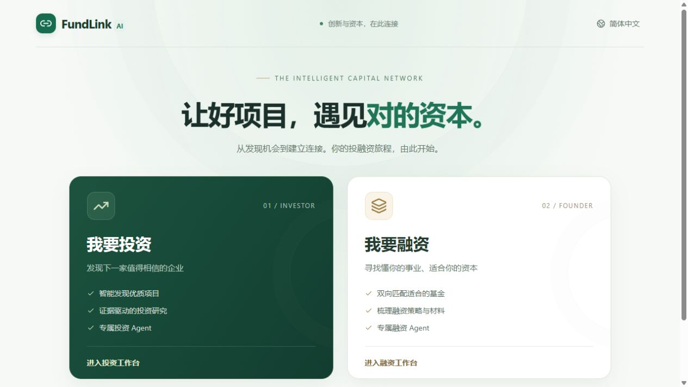
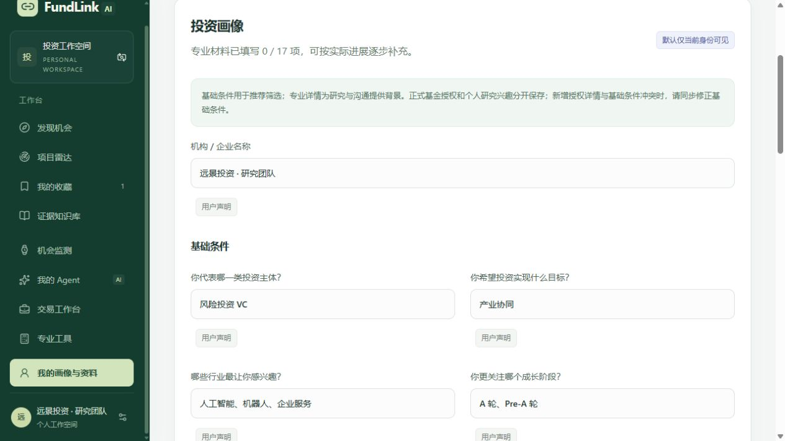
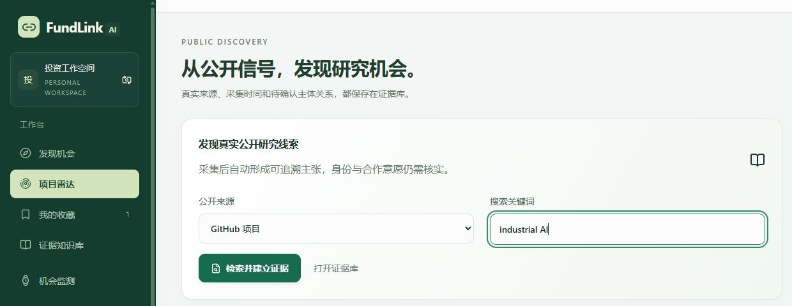
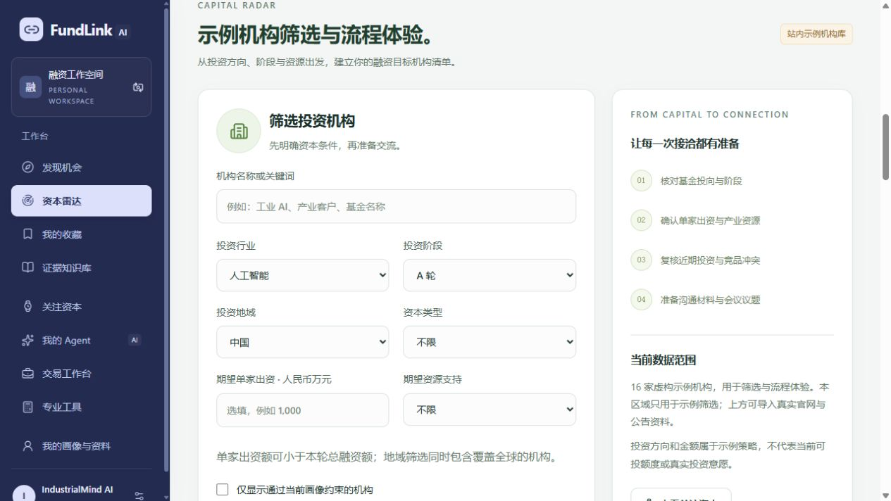
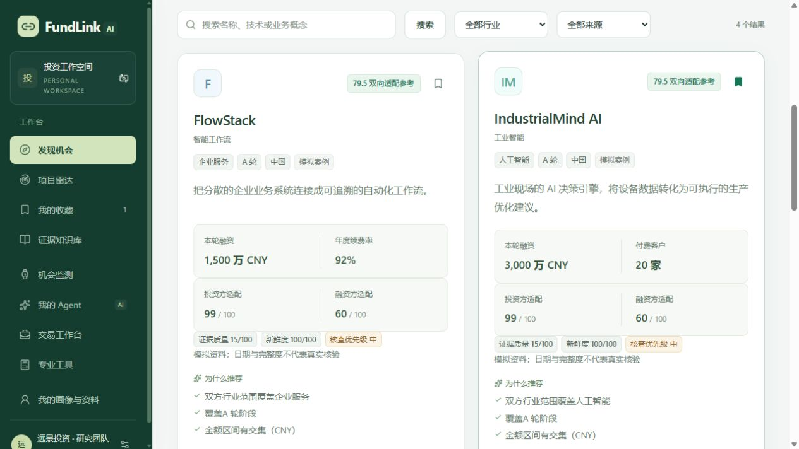
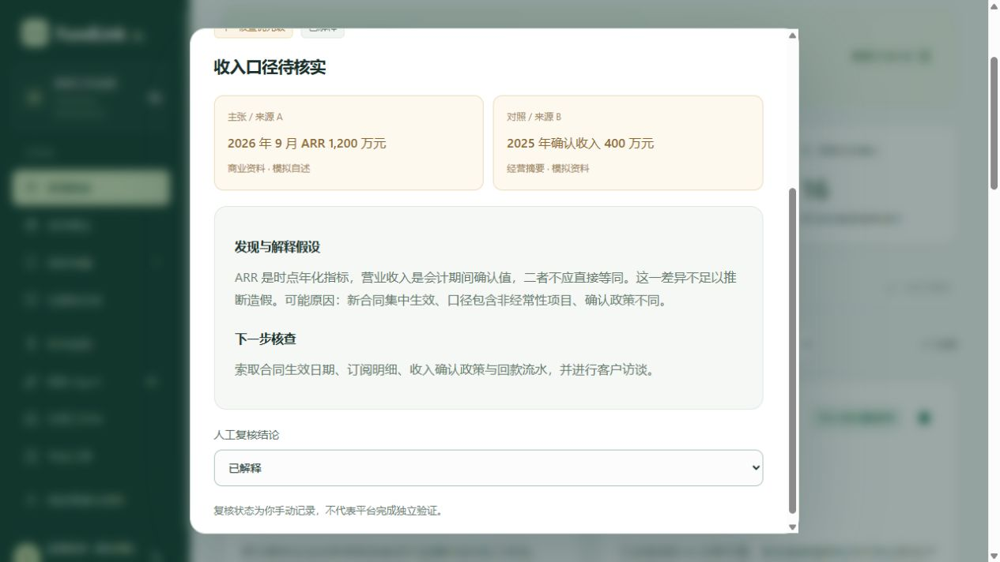
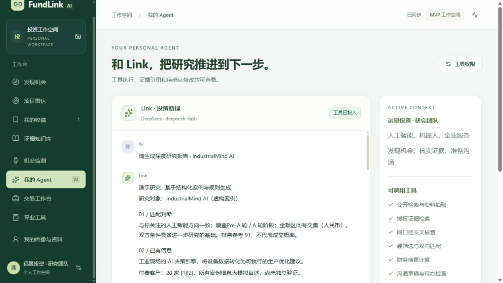

# FundLink AI｜产品设计与功能方案

让企业拥有融资 Agent，让投资方拥有投资 Agent，用共同的证据、匹配与反馈机制，把分散的信息变成可以继续研究和推进的机会。

## 一、方案信息卡

| 项目 | 说明 |
|---|---|
| 产品定位 | 面向投资方与融资方的 AI 双边匹配平台 |
| 服务对象 | 投资人、投资机构研究团队，以及创业者、企业融资负责人 |
| 产品形态 | 一个网站，投资与融资两个工作空间 |
| 核心能力 | AI 建档、双侧数据挖掘、跨源核查、双向匹配、个人 Agent、业务反馈 |
| 当前阶段 | 可本地运行的功能型 Demo；真实工具链与明确标识的模拟案例并存 |
| 项目源码 | [GitHub 公开仓库](https://github.com/senizuaki-bit/fundlink-ai) |

## 二、方案成果展示

### 2.1 体验入口与 Demo

首页先让用户选择“我要投资”或“我要融资”，再进入对应的工作空间。投资端用深绿侧栏，融资端用蓝紫侧栏，明确区分双方的任务和视角。产品保留相似的操作习惯，但推荐对象、采集来源和分析问题随角色变化。

图 1｜实际产品首页：先选择角色，再进入对应的投融资流程。

按仓库 README 安装并启动后，可通过本机地址 http://127.0.0.1:5173 体验。以下均为当前产品实机截图；界面中的“模拟案例”“示例机构”和历史模拟报告用于展示流程，不代表已核实的商业事实或真实合作意愿。

### 2.2 命题场景与核心痛点

**投资方的问题是“信息很多，却难形成判断”。** 一个技术项目可能同时出现在 GitHub、官网、新闻和商业计划书中。研究者需要确认是否属于同一主体、资料是否过期、不同指标能否比较，再判断它是否满足自己的投资条件。

**融资方的问题是“知道机构名字，却不知道资金是否合适”。** 企业不仅要找钱，还要考虑阶段、单家出资额、产业资源、决策周期和竞品冲突。同一机构管理的不同基金，也可能有不同的币种与投资范围。

因此，FundLink 要连接的是一段完整工作：明确需求 → 发现线索 → 建立画像 → 核查证据 → 双向匹配 → 沟通与反馈。搜索是入口，后续的主体识别、交叉分析和持续跟进，才是产品要补上的环节。

### 2.3 设计思路与核心特色

**借鉴招聘产品，降低开始使用的门槛。** 先选角色、建立基础资料，再浏览推荐、换一批、表达兴趣并逐步沟通。用户不必一开始就懂全部金融术语，也可以回答“不确定”。

**双方都需要被理解，也都需要主动找信息。** 平台既挖掘企业与项目，也挖掘资本与机构；不仅判断投资方是否看好企业，还判断企业是否适合接受这类资金。

**让判断有依据，让反馈能回到下一轮。** 每条重要信息保留来源与时间，适配分、证据质量和风险分别表达。用户纠正资料、调整需求或记录业务结果后，平台在授权范围内更新后续研究与推荐。

### 2.4 具体方案与功能设计

#### 2.4.1 AI 建档：先建立基础画像，再逐步完善

注册引导围绕约十个维度，通过文字、选项或可编辑语音转写了解用户。投资侧关注投资主体、行业、阶段、单笔金额、地域及限制；融资侧关注企业阶段、资金用途、融资金额、时间要求与资源诉求。

初次建档之后，用户仍可修改基础条件、补充专业资料。系统区分用户声明、自述事实、AI 推断与人工核验；浏览行为不能擅自改写硬条件。当前使用预设维度和有限追问，复杂动态访谈是后续扩展方向。

图 2｜示例投资画像：基础条件与字段来源可见，专业资料允许逐步补充。

#### 2.4.2 双侧数据挖掘：投资找项目，企业找资本

投资侧的项目雷达支持从 GitHub、Hugging Face、arXiv、官网等来源发现研究线索。检索结果进入证据库，保留出处、采集时间与主体状态。开源仓库首先是技术线索，不能直接当成正在融资的公司；项目与企业的关联需要进一步确认。

图 3｜项目雷达：选择公开来源并检索，后续把资料沉淀为可回看的证据。

融资侧使用资本雷达，导入机构官网和公告，研究基金偏好、公开投资案例及可能提供的资源。机构筛选同时考虑行业、阶段、地域、单家出资额和资源诉求，帮助企业形成有理由的接洽名单。当前真实资料导入与站内示例机构筛选分开呈现。

图 4｜融资端资本雷达：图中展示示例机构筛选，保留数据范围说明。

#### 2.4.3 双向匹配：两边都合适，才值得继续

匹配先检查阶段、币种、金额、地域及排除条件，再对候选计算两个方向的适配参考：投资方是否适合投这家企业，以及企业是否适合接受这类资金。检索结合关键词与概念关联，排序再考虑明确偏好、经授权的反馈和适度多样性。

推荐卡片同时展示匹配理由、证据质量、资料缺口与建议下一步。条件未知的对象进入探索区；已知不符的对象说明原因，不靠提高相似度绕过硬条件。“换一批”帮助用户继续探索，但不会自动放宽要求。匹配分不是成交概率，也不表示另一位真实用户已同意合作。

图 5｜模拟项目推荐：投资方与融资方适配分别展示，证据质量和核查优先级独立呈现。

#### 2.4.4 跨源核查：把差异变成具体问题

核查先判断数据是否可比，再解释差异。例如演示案例中，“2026 年 9 月 ARR 1,200 万元”与“2025 年确认收入 400 万元”分别对应时点年化口径和期间会计口径，不能直接相减后认定造假。

系统将双方来源并列，提出可能解释和补充材料清单，再由用户复核。投资侧重点关注商业化、客户和财务口径；融资侧还需关注资本授权、竞品冲突及合作条款。风险提示用于安排调查，不替代审计或最终决策。

图 6｜模拟收入口径核查：从来源对照，走到解释假设、核查建议和人工复核。

#### 2.4.5 个人 Agent：围绕任务调用工具

双方都可以配置自己的 Agent，带着当前画像、研究对象和允许使用的资料开展工作。用户可以要求它发现项目、比较资本、整理尽调问题、生成沟通草稿，或调用现金跑道、股权稀释等计算工具。

Agent 的工作过程应能回看：用了什么工具、依据哪些资料、哪些结论仍待确认。模型负责理解需求和解释结果，金额与情景计算由确定性工具完成。资料使用受权限约束；当前交易工作台中的对外沟通和双方确认采用模拟流程。

图 7｜个人 Agent：截图为历史模拟研究报告，右侧展示当前上下文和可用工具。

#### 2.4.6 数据飞轮：连接双端的共用机制

数据飞轮位于平台架构中，双方正常使用产品就会参与其中。收藏、拒绝、资料纠正和业务进展形成事件，经授权与来源检查后，回到下一轮画像建议、证据核查和匹配排序。

这包含两条相互配合的循环：匹配反馈帮助理解双方需求，证据反馈帮助提高资料质量。私有材料仍保留各自权限，行为学习由用户开启，偏好建议需确认；模拟结果和真实业务分开处理。当前已有共用事件与规则反馈，跨账户真实协作和共同学习仍需继续建设。

图 8｜数据飞轮：反馈来自双端业务流程，经共同处理层回到下一轮发现与判断。

#### 2.4.7 技术架构：共用服务支撑两个工作空间

前端提供两套角色体验，后端共用证据服务、匹配服务、Agent 编排和业务工作流。统一事件层负责记录来源、过滤授权并生成反馈；发现列表、详情与 Agent 使用同一套匹配依据，避免各自给出相互矛盾的结果。

当前采用 React / TypeScript、D1 / R2 和可配置的模型接口。后续持续采集需要增加任务队列与云端调度；真实双边协作需要主体认领、组织权限和双方独立确认。公开仓库保留源码与配置示例，模型密钥和私人运行数据不随源码发布。

图 9｜系统分工：两个业务界面共享数据与智能服务，规划能力在图中单独标出。

### 2.5 方案价值与验证方式

对投资方，价值是减少重复检索和整理，把时间集中在证据与判断；对企业，价值是明确资金需求、比较适合的资本，并更充分地准备沟通。平台长期积累的是有来源的主体知识和经授权的反馈。

效果需要真实试用验证：完成同一研究任务是否更快、推荐理由是否有用、关键资料是否补齐，以及有效回复和会谈是否增加。当前 Demo 能展示这条链路，尚不能据此宣称提升了融资成功率。

## 三、演示方式与产品成长

### 3.1 用一个案例讲清整条链路

以虚构的 IndustrialMind AI 为例：投资方先明确“工业 AI、A 轮、有付费客户”的条件，查看推荐和收入口径差异，再让 Agent 整理核查问题；切换融资视角，围绕融资金额与产业客户诉求筛选资本。最后记录反馈，说明它如何经共用事件层影响后续研究，而不是由用户点击“运行飞轮”。

### 3.2 当前实现边界

**已具备：** 双端入口与画像、按次公开检索、证据入库、基础跨源核查、双向匹配、工具型 Agent、金融情景计算和授权反馈。

**局部支持：** 语音依赖浏览器能力；资料解析支持文本 PDF 等格式；已有来源巡检依赖本地进程；外部搜索及模型能力依赖服务配置。

**后续重点：** 定时发现全新项目与资本线索、真实跨账户协作、双方确认及真实样本评估。已有网址巡检与新线索持续发现是两类不同任务。

### 3.3 成长路线

| 阶段 | 重点工作 | 验证目标 |
|---|---|---|
| 完善 Demo | 打磨发现、核查、匹配和 Agent 的完整体验 | 用户能说清推荐依据与下一步 |
| 小范围试用 | 持续发现、真实主体认领与双边协作 | 有真实资料、独立反馈和有效沟通 |
| 持续优化 | 受控调度、来源质量评估与排序实验 | 用同一口径证明双方效率改善 |

## 四、后续愿景与项目资料

FundLink 希望成为持续陪伴双方研究与沟通的工作空间：企业和资本的公开信息不断更新，用户的需求逐步清晰，AI 始终围绕可信资料帮助双方判断是否值得继续、缺什么信息、下一步该做什么。

[GitHub 项目源码与启动说明](https://github.com/senizuaki-bit/fundlink-ai) · [详细设计与技术边界](https://github.com/senizuaki-bit/fundlink-ai/blob/main/docs/PRODUCT_DESIGN.md)

本方案依据最初的产品构想、原始 PRD 和当前代码整理；产品截图采自本地运行版本，保留示例数据标识。详细规则、数据对象和工程验收记录放在仓库中，正文集中说明产品为什么这样设计、用户如何使用，以及下一步如何验证。
